# DESIGN:OS (`design-os`)

**Multi-runtime design operating system and CLI for Claude Code, OpenAI Codex, Gemini CLI, and Google Antigravity.**

Install once to equip any AI coding agent with 12+ domain design skills, deterministic verification gates, 2:1 axonometric art direction, and live Figma / SVG / 3D / SwiftUI / packaging workflows.

<p align="center">
  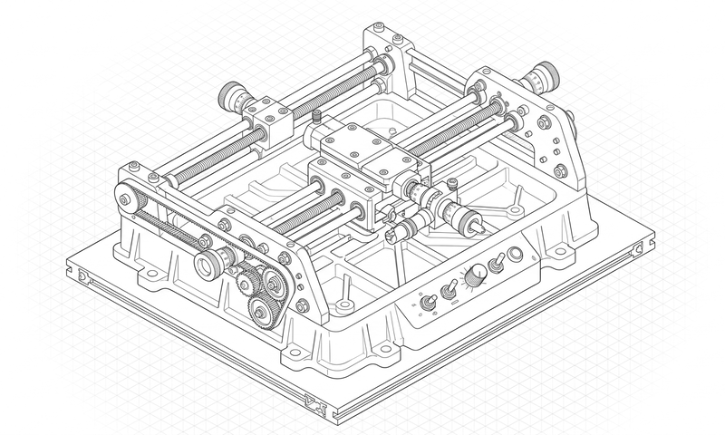
</p>

<p align="center">
  <a href="LICENSE"></a>
  
  <a href="commands/doctor.md"></a>
  <a href="https://jangtrinh.github.io/design-os/"></a>
  <a href="https://buymeacoffee.com/jangtrinh"></a>
</p>

<p align="center">
  <a href="#quickstart">Quickstart</a> · <a href="#what-it-makes">What it makes</a> · <a href="#installation">Install</a> · <a href="#how-it-works">How it works</a> · <a href="#commands--diagnostics">Commands</a> · <a href="#quality-bar--limitations">Limits</a>
</p>

---

## Why this exists

AI coding agents write functional code quickly, but their default visual output suffers from inconsistent spacing, hallucinated tokens, rainbow badges, and zero verification gates. **DESIGN:OS** turns aesthetic taste and design systems engineering into deterministic, runtime-agnostic contracts.

| Dimension | Generic AI / Manual Workflow | DESIGN:OS CLI (`DESIGN:OS`) |
| :--- | :--- | :--- |
| **Visual Quality** | Generic purple-gradient AI slop and ad-hoc CSS | Token-locked typography, 8pt modular grid, and 2:1 axonometric art direction |
| **Context Budget** | Dumping massive style guides into every prompt | Progressive skill disclosure (`SKILL.md` router + on-demand domain packs) |
| **Verification** | Visual eyeballing with zero automated checks | Deterministic CLI gates (`self_check.py`, contrast, and anti-flop audits) |
| **Multi-Agent Parity** | Locked to a single IDE or proprietary prompt format | One canonical skill tree across Claude Code, Codex, Gemini CLI & Antigravity |
| **Privacy & Telemetry** | Opaque cloud telemetry or unverified third-party APIs | **Zero telemetry** — 100% local execution ([`PRIVACY.md`](PRIVACY.md) audited) |

---

## Quickstart

### 1. Install the plugin or CLI

**In Claude Code:**

```text
/plugin marketplace add jangtrinh/design-os
/plugin install design-os@design-os
```

**Or from your terminal (Codex, Gemini CLI, Antigravity, OpenCode, or standalone CLI):**

```bash
git clone https://github.com/jangtrinh/design-os.git
cd design-os
npx @easestart/design-os init
```

### 2. Ask in plain English

Open your project in your AI coding agent and describe what you need:

> "Initialize DESIGN:OS in this repo and wire our design tokens and verification gates for Claude Code and Codex."

> "Audit our current frontend components against DESIGN:OS typography, spacing, and WCAG 2.2 AA contrast gates."

> "Scaffold a new product landing page with 2:1 axonometric B&W technical illustrations and SEO/AEO/GEO metadata."

### 3. Verify your setup

```bash
python3 scripts/self_check.py
```

---

## What it makes

Every deliverable produced by `design-os` is backed by a deterministic verification gate rather than freehand AI guesswork.

<p align="center">
  <br>
  <sub>Prompt: <code>"Initialize DESIGN:OS in this repo and wire our design tokens and verification gates for Claude Code and Codex."</code></sub>
</p>

| Deliverable / Mode | Best for | Output Format | Verification Gate |
| :--- | :--- | :--- | :--- |
| **Multi-Runtime Skill Pack** | Wiring Claude Code, Codex, Gemini CLI, and Antigravity to one design standard | `.claude-plugin + skills/` | `python3 scripts/self_check.py` |
| **Design System Tokens & Gates** | Enforcing spacing, typography, and WCAG 2.2 AA contrast in CI | `JSON / CSS / CLI exit code` | `Zero contrast or grid violations` |
| **Cross-Engine Orchestration** | Routing tasks to Figma, SVG Animation, 3D Blender, Apple SwiftUI, or Origami CAD | `Verified domain artifacts` | `13-engine ecosystem parity` |
| **Design-System Guidelines Pack** | Teaching any design agent the rules a library cannot show — owner rulings, look-alike components, measured anti-patterns — and shipping them as a Figma library guidelines bundle | `design/guidelines/*.md + figma-guidelines/` | `ui ds guidelines check` — no invented names, no tampered facts, Figma's 8-file / 200 KB limits |

<!-- BEGIN:examples-grid (generated by scripts/build-examples-gallery.mjs) -->

<table>
<tr>
<td width="50%"><a href="https://jangtrinh.github.io/design-os/examples/diagrams/architecture.html" title="Three-tier web application — open the live artifact"><picture><source media="(prefers-color-scheme: dark)" srcset="docs/images/examples/diagrams/architecture-dark.png">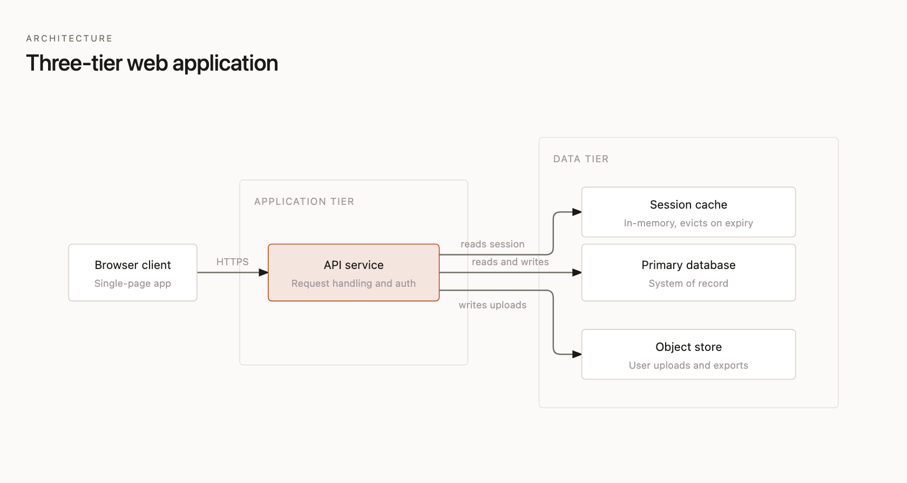</picture></a><br><sub><b>architecture</b> — Three-tier web application</sub></td>
<td width="50%"><a href="https://jangtrinh.github.io/design-os/examples/diagrams/medallion.html" title="Survey dataset storage tiers — open the live artifact"><picture><source media="(prefers-color-scheme: dark)" srcset="docs/images/examples/diagrams/medallion-dark.png">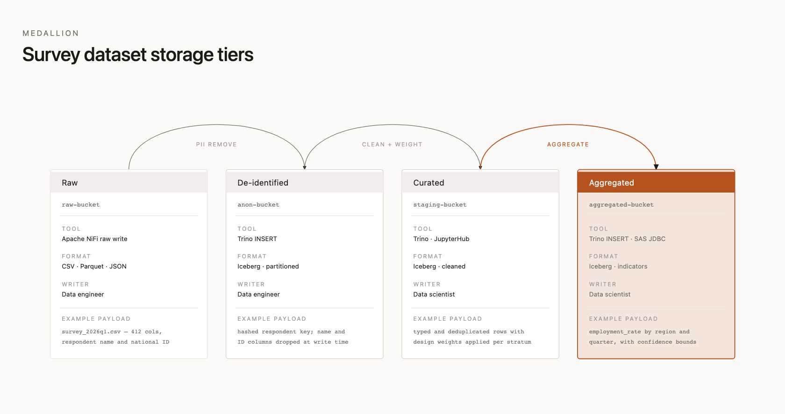</picture></a><br><sub><b>medallion</b> — Survey dataset storage tiers</sub></td>
</tr>
<tr>
<td width="50%"><a href="https://jangtrinh.github.io/design-os/examples/charts/bar.html" title="Revenue by region, FY2025 — open the live artifact"><picture><source media="(prefers-color-scheme: dark)" srcset="docs/images/examples/charts/bar-dark.png">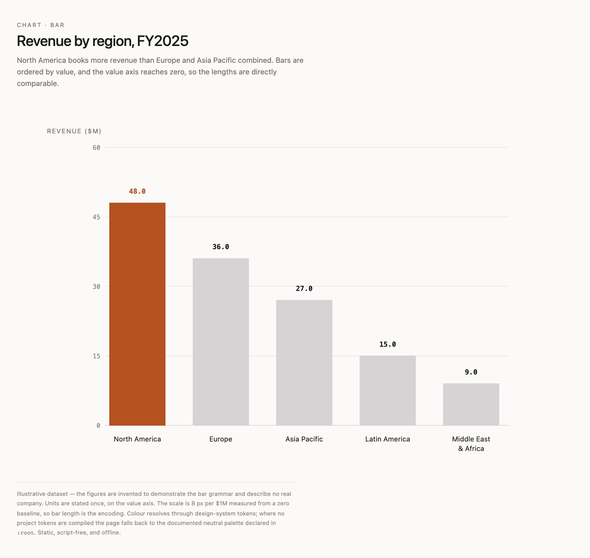</picture></a><br><sub><b>bar</b> — Revenue by region, FY2025</sub></td>
<td width="50%"><a href="https://jangtrinh.github.io/design-os/examples/charts/quadrant.html" title="Q3 initiatives by effort and impact — open the live artifact"><picture><source media="(prefers-color-scheme: dark)" srcset="docs/images/examples/charts/quadrant-dark.png">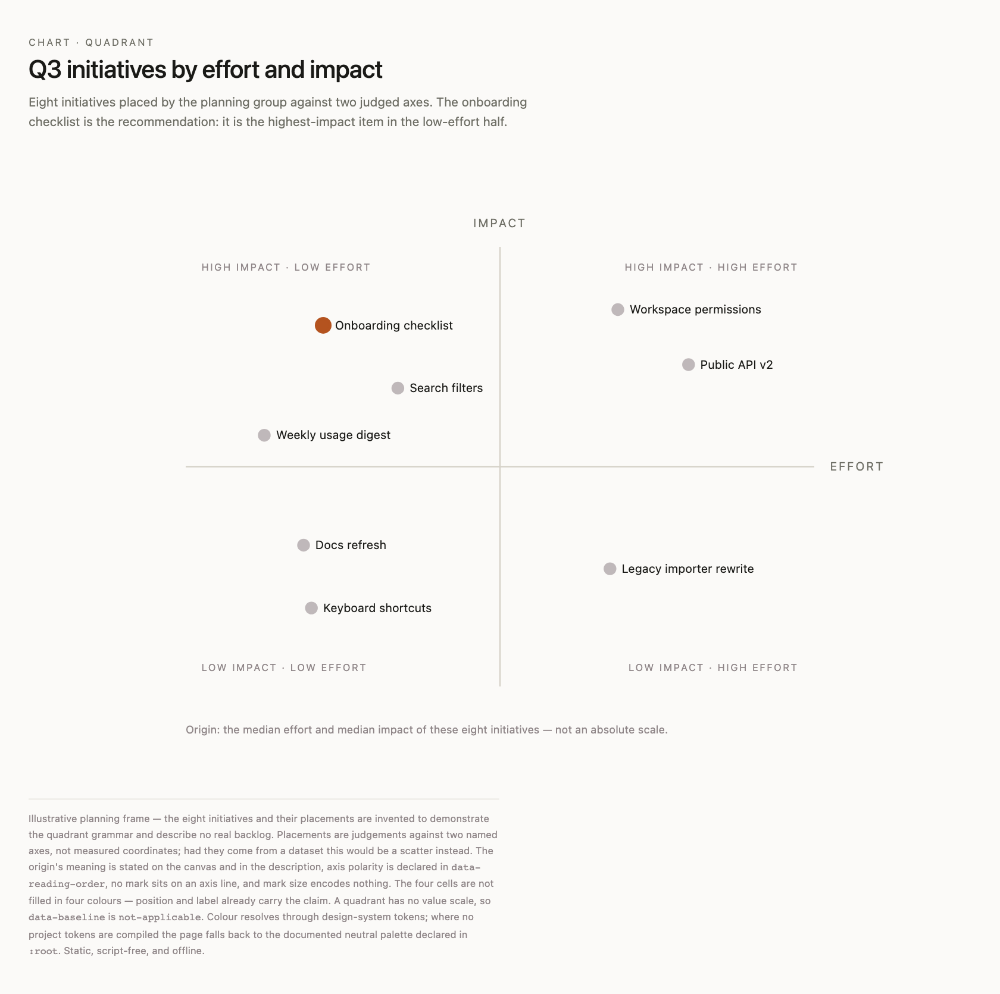</picture></a><br><sub><b>quadrant</b> — Q3 initiatives by effort and impact</sub></td>
</tr>
</table>

<details>
<summary><b>All 28 grammars rendered</b> — every one of these is a committed artifact that passes its linter with zero findings</summary>

<table>
<tr>
<td width="33%"><a href="https://jangtrinh.github.io/design-os/examples/diagrams/data-flow.html" title="Nightly reporting run — open the live artifact"><picture><source media="(prefers-color-scheme: dark)" srcset="docs/images/examples/diagrams/data-flow-dark.png">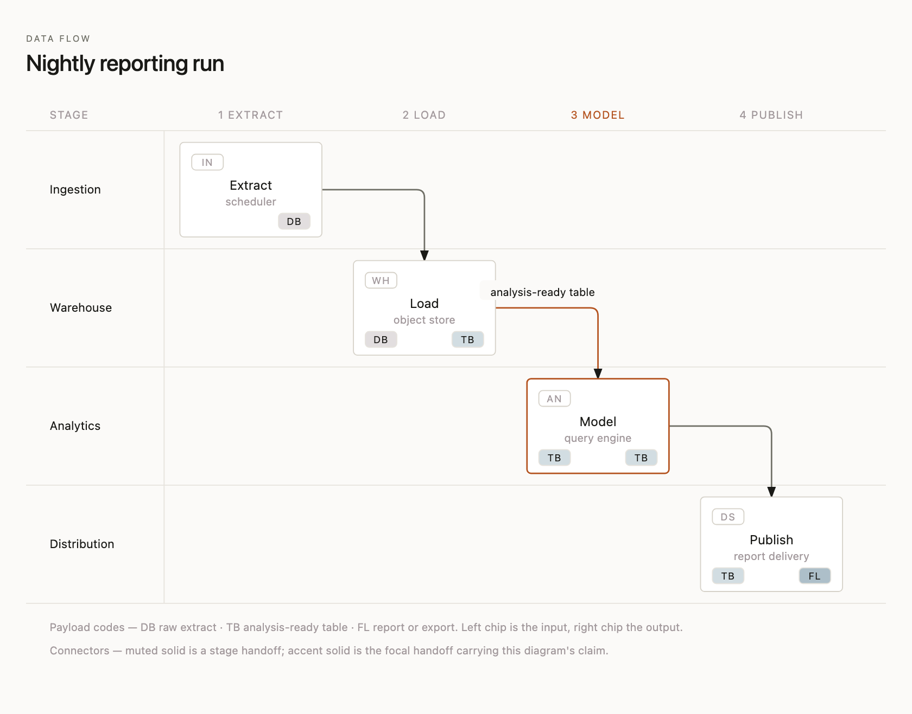</picture></a><br><sub><b>data-flow</b></sub></td>
<td width="33%"><a href="https://jangtrinh.github.io/design-os/examples/diagrams/dp-integration.html" title="Data platform integration surfaces — open the live artifact"><picture><source media="(prefers-color-scheme: dark)" srcset="docs/images/examples/diagrams/dp-integration-dark.png">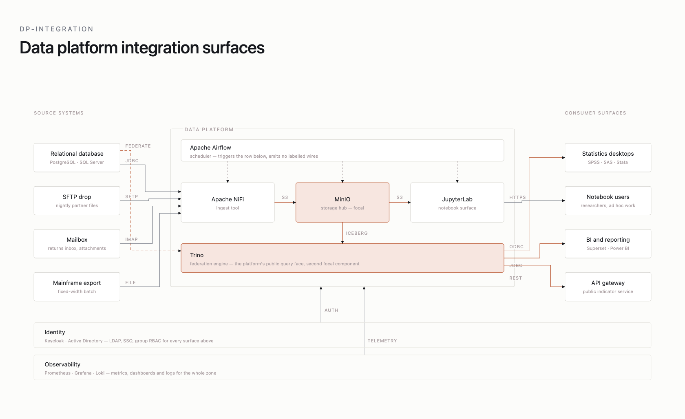</picture></a><br><sub><b>dp-integration</b></sub></td>
<td width="33%"><a href="https://jangtrinh.github.io/design-os/examples/diagrams/dp-security-matrix.html" title="Platform entitlement matrix — open the live artifact"><picture><source media="(prefers-color-scheme: dark)" srcset="docs/images/examples/diagrams/dp-security-matrix-dark.png">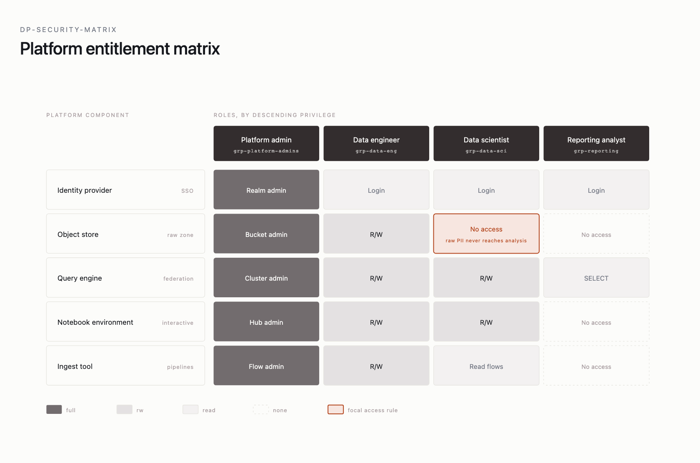</picture></a><br><sub><b>dp-security-matrix</b></sub></td>
</tr>
<tr>
<td width="33%"><a href="https://jangtrinh.github.io/design-os/examples/diagrams/er.html" title="Order model — open the live artifact"><picture><source media="(prefers-color-scheme: dark)" srcset="docs/images/examples/diagrams/er-dark.png">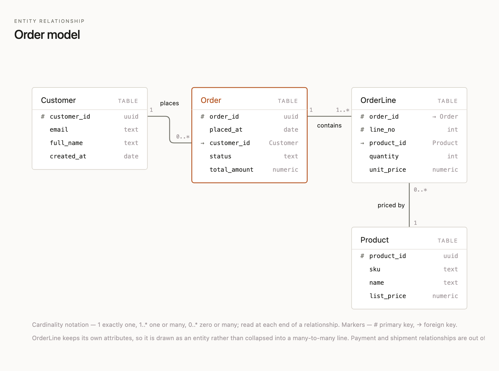</picture></a><br><sub><b>er</b></sub></td>
<td width="33%"><a href="https://jangtrinh.github.io/design-os/examples/diagrams/flowchart.html" title="Loan eligibility check — open the live artifact"><picture><source media="(prefers-color-scheme: dark)" srcset="docs/images/examples/diagrams/flowchart-dark.png">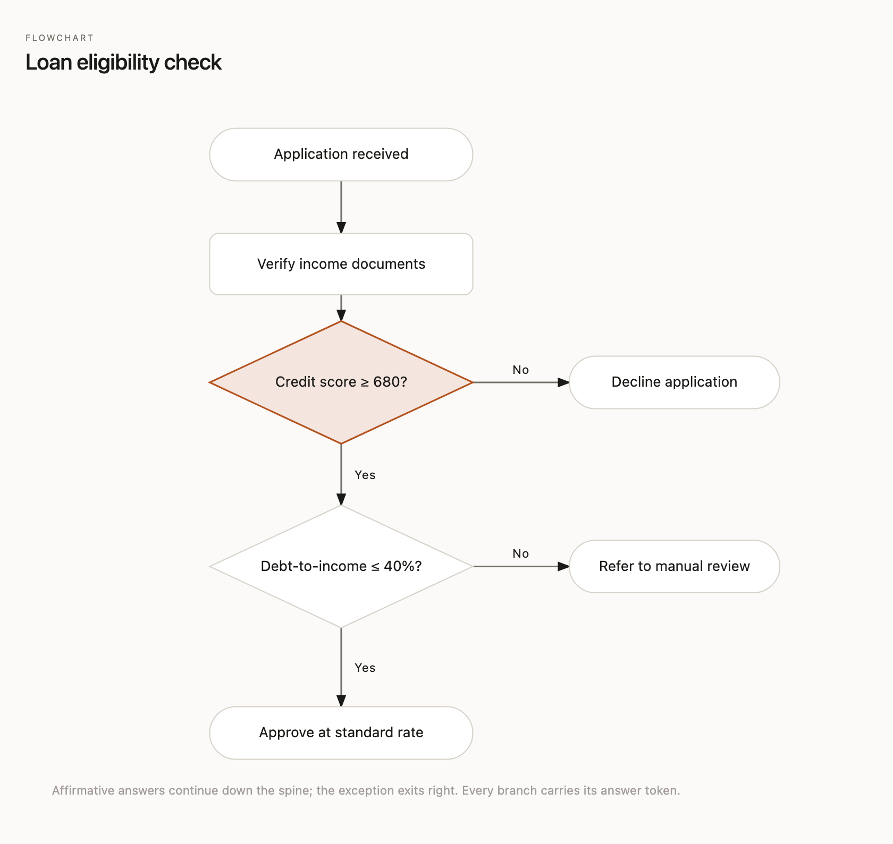</picture></a><br><sub><b>flowchart</b></sub></td>
<td width="33%"><a href="https://jangtrinh.github.io/design-os/examples/diagrams/high-level.html" title="Lakehouse capability sweep — open the live artifact"><picture><source media="(prefers-color-scheme: dark)" srcset="docs/images/examples/diagrams/high-level-dark.png">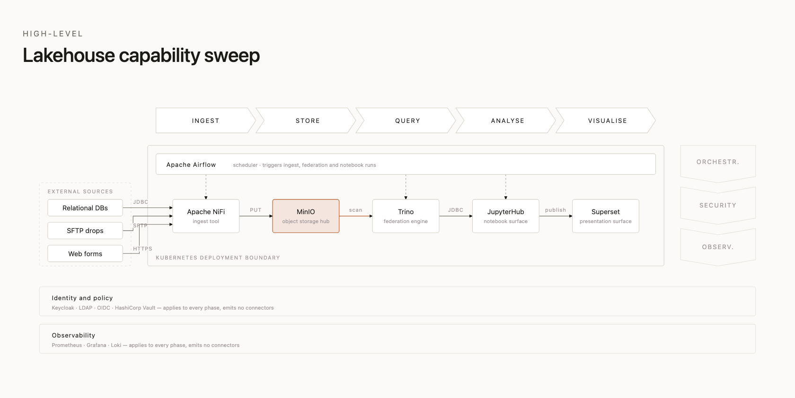</picture></a><br><sub><b>high-level</b></sub></td>
</tr>
<tr>
<td width="33%"><a href="https://jangtrinh.github.io/design-os/examples/diagrams/it-state.html" title="Statistics estate before modernisation — open the live artifact"><picture><source media="(prefers-color-scheme: dark)" srcset="docs/images/examples/diagrams/it-state-dark.png">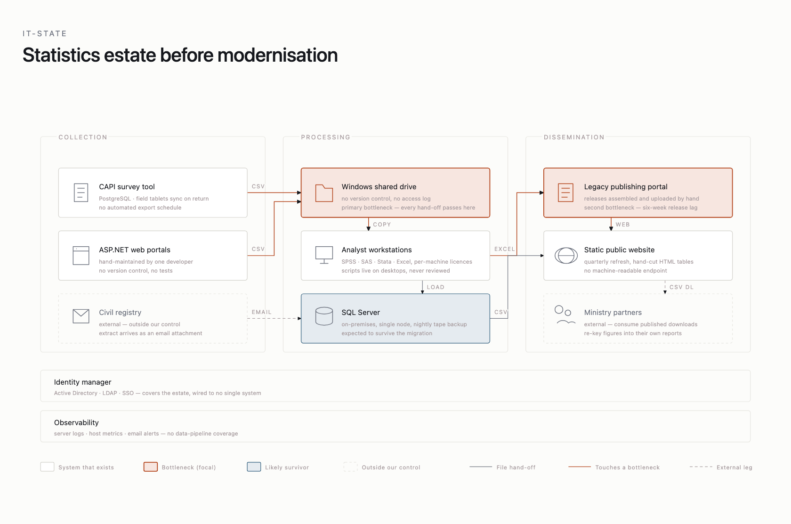</picture></a><br><sub><b>it-state</b></sub></td>
<td width="33%"><a href="https://jangtrinh.github.io/design-os/examples/diagrams/layers.html" title="Runtime stack, hardware upward — open the live artifact"><picture><source media="(prefers-color-scheme: dark)" srcset="docs/images/examples/diagrams/layers-dark.png">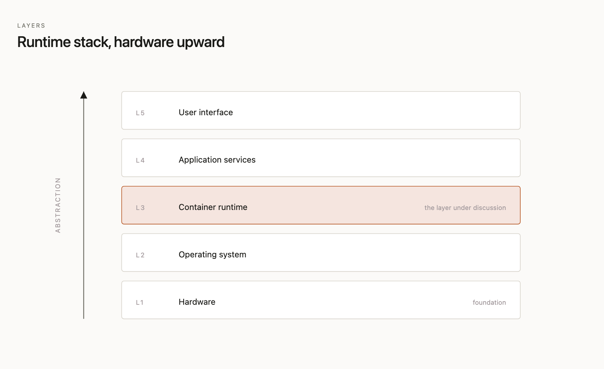</picture></a><br><sub><b>layers</b></sub></td>
<td width="33%"><a href="https://jangtrinh.github.io/design-os/examples/diagrams/loop.html" title="Platform operating cycle — open the live artifact"><picture><source media="(prefers-color-scheme: dark)" srcset="docs/images/examples/diagrams/loop-dark.png">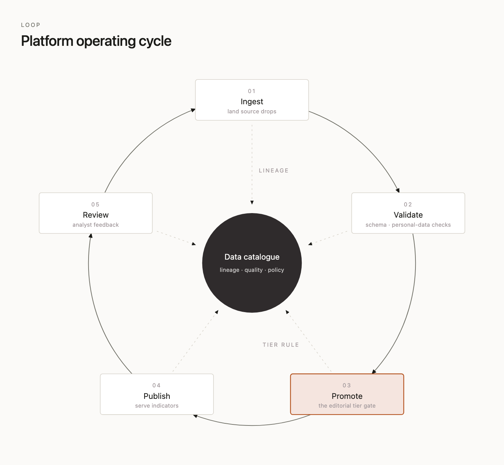</picture></a><br><sub><b>loop</b></sub></td>
</tr>
<tr>
<td width="33%"><a href="https://jangtrinh.github.io/design-os/examples/diagrams/nested.html" title="Trust zones, outside in — open the live artifact"><picture><source media="(prefers-color-scheme: dark)" srcset="docs/images/examples/diagrams/nested-dark.png">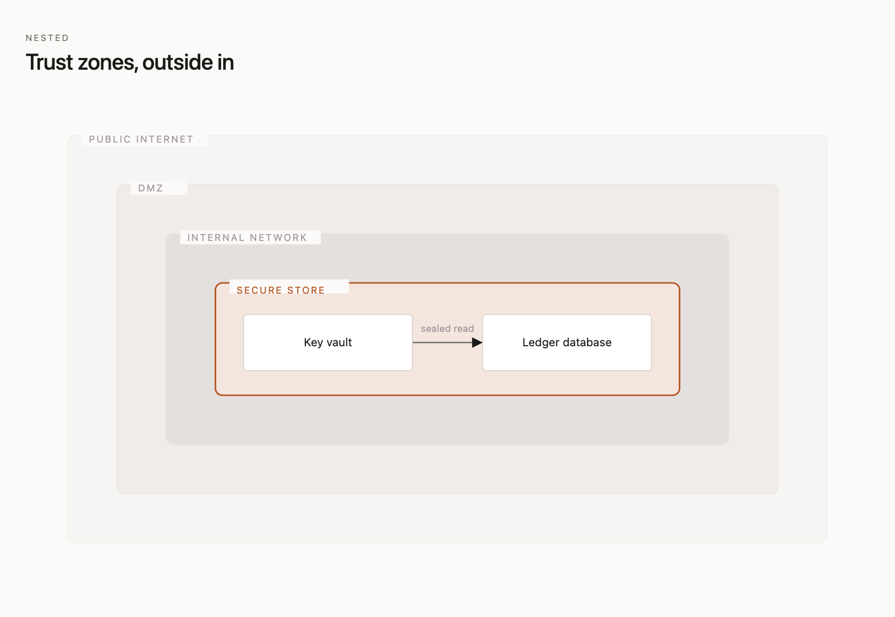</picture></a><br><sub><b>nested</b></sub></td>
<td width="33%"><a href="https://jangtrinh.github.io/design-os/examples/diagrams/org-chart.html" title="Engineering, who to reach — open the live artifact"><picture><source media="(prefers-color-scheme: dark)" srcset="docs/images/examples/diagrams/org-chart-dark.png">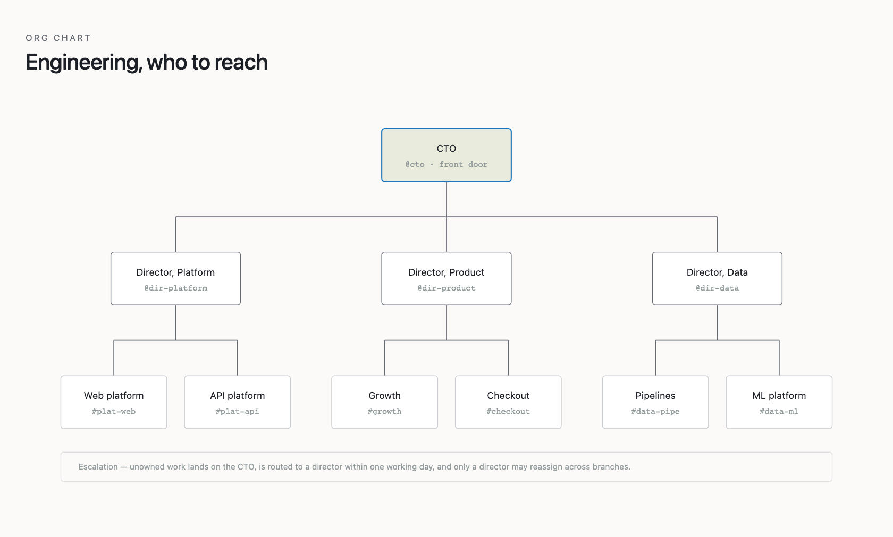</picture></a><br><sub><b>org-chart</b></sub></td>
<td width="33%"><a href="https://jangtrinh.github.io/design-os/examples/diagrams/process.html" title="Incident response runbook — open the live artifact"><picture><source media="(prefers-color-scheme: dark)" srcset="docs/images/examples/diagrams/process-dark.png">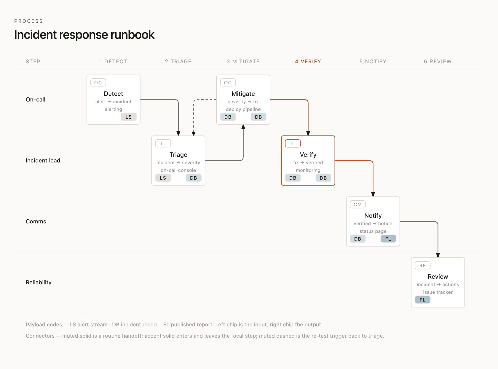</picture></a><br><sub><b>process</b></sub></td>
</tr>
<tr>
<td width="33%"><a href="https://jangtrinh.github.io/design-os/examples/diagrams/product-flow.html" title="Checkout flow, partial view — open the live artifact"><picture><source media="(prefers-color-scheme: dark)" srcset="docs/images/examples/diagrams/product-flow-dark.png">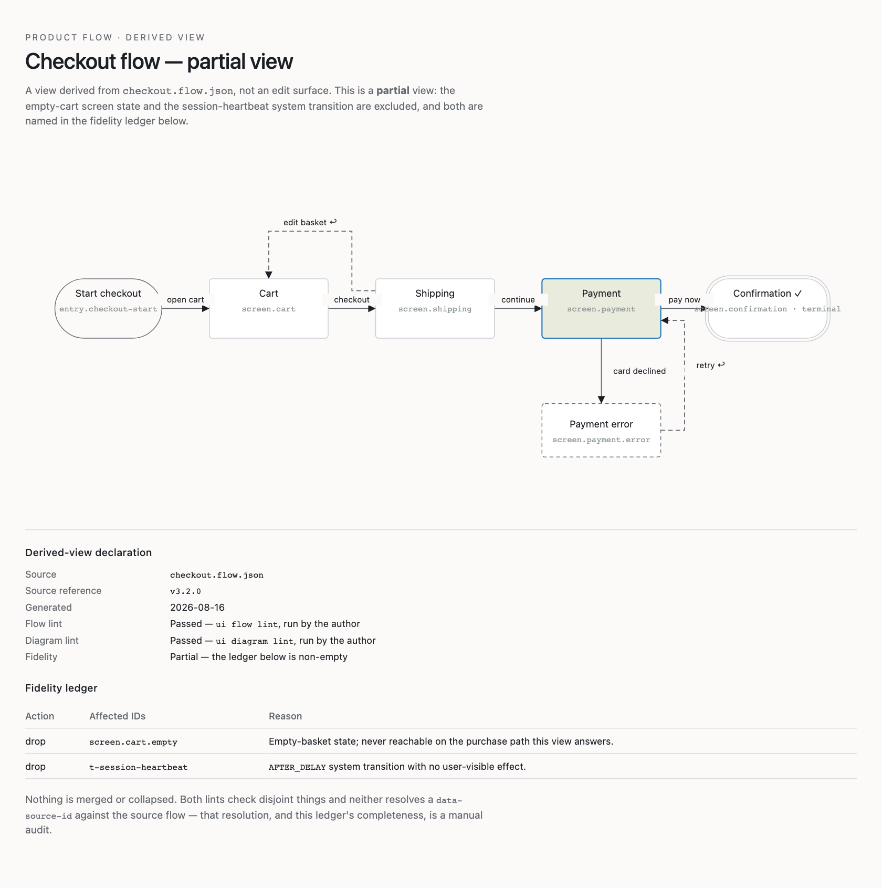</picture></a><br><sub><b>product-flow</b></sub></td>
<td width="33%"><a href="https://jangtrinh.github.io/design-os/examples/diagrams/sequence.html" title="User sign-in exchange — open the live artifact"><picture><source media="(prefers-color-scheme: dark)" srcset="docs/images/examples/diagrams/sequence-dark.png">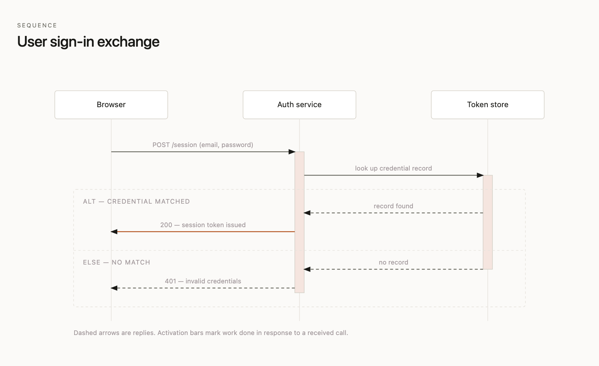</picture></a><br><sub><b>sequence</b></sub></td>
<td width="33%"><a href="https://jangtrinh.github.io/design-os/examples/diagrams/state.html" title="Subscription lifecycle — open the live artifact"><picture><source media="(prefers-color-scheme: dark)" srcset="docs/images/examples/diagrams/state-dark.png">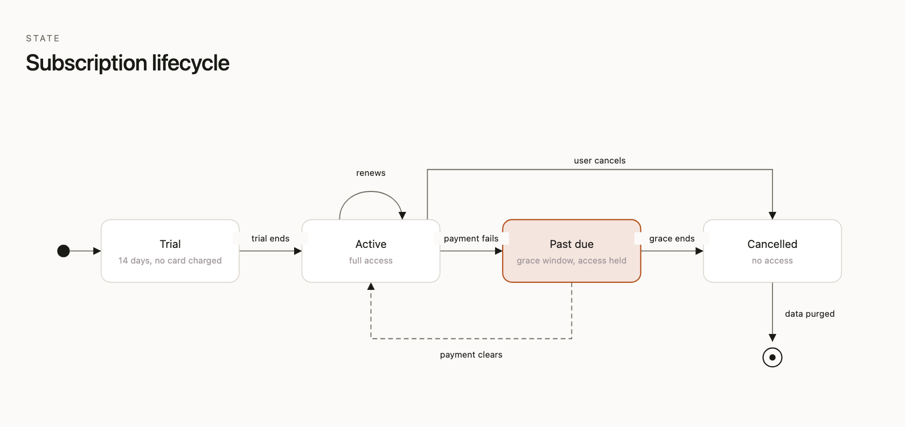</picture></a><br><sub><b>state</b></sub></td>
</tr>
<tr>
<td width="33%"><a href="https://jangtrinh.github.io/design-os/examples/diagrams/swimlane.html" title="Expense claim ownership — open the live artifact"><picture><source media="(prefers-color-scheme: dark)" srcset="docs/images/examples/diagrams/swimlane-dark.png">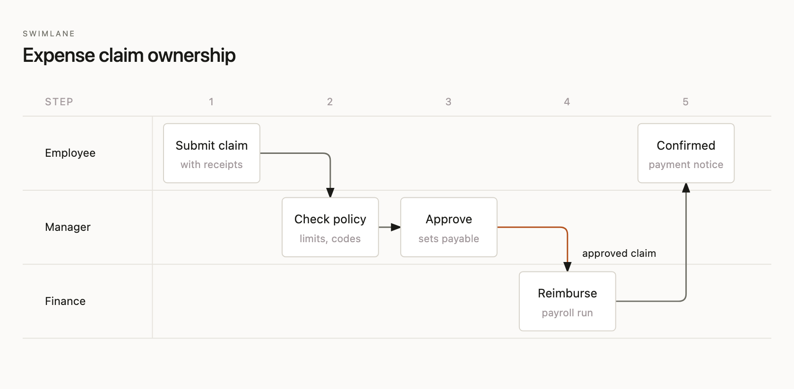</picture></a><br><sub><b>swimlane</b></sub></td>
<td width="33%"><a href="https://jangtrinh.github.io/design-os/examples/diagrams/tree.html" title="Catalogue taxonomy, root at the leading edge — open the live artifact"><picture><source media="(prefers-color-scheme: dark)" srcset="docs/images/examples/diagrams/tree-dark.png">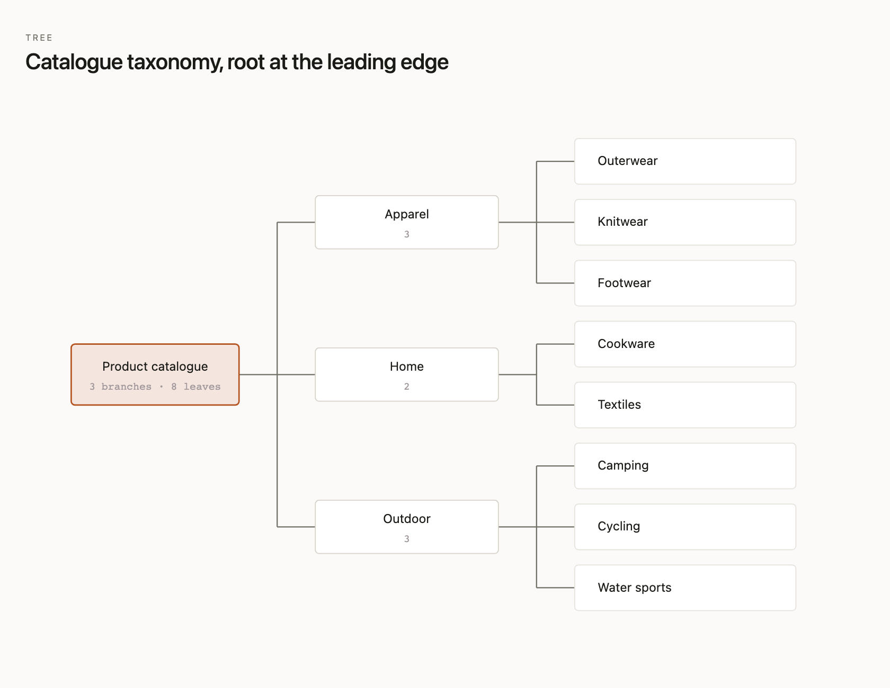</picture></a><br><sub><b>tree</b></sub></td>
<td width="33%"><a href="https://jangtrinh.github.io/design-os/examples/charts/gantt.html" title="Reporting platform plan, H1 2026 — open the live artifact"><picture><source media="(prefers-color-scheme: dark)" srcset="docs/images/examples/charts/gantt-dark.png">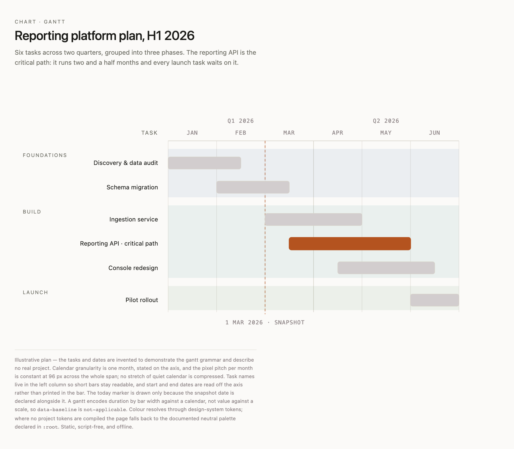</picture></a><br><sub><b>gantt</b></sub></td>
</tr>
<tr>
<td width="33%"><a href="https://jangtrinh.github.io/design-os/examples/charts/line.html" title="Monthly active users, 2025 — open the live artifact"><picture><source media="(prefers-color-scheme: dark)" srcset="docs/images/examples/charts/line-dark.png">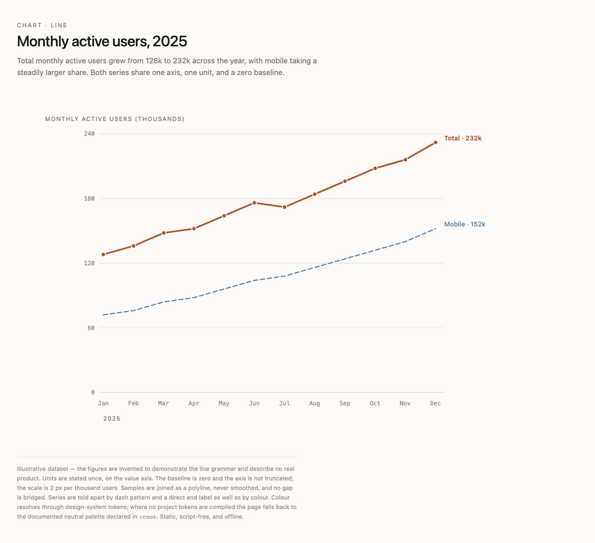</picture></a><br><sub><b>line</b></sub></td>
<td width="33%"><a href="https://jangtrinh.github.io/design-os/examples/charts/pyramid.html" title="Self-serve conversion funnel, Q2 — open the live artifact"><picture><source media="(prefers-color-scheme: dark)" srcset="docs/images/examples/charts/pyramid-dark.png">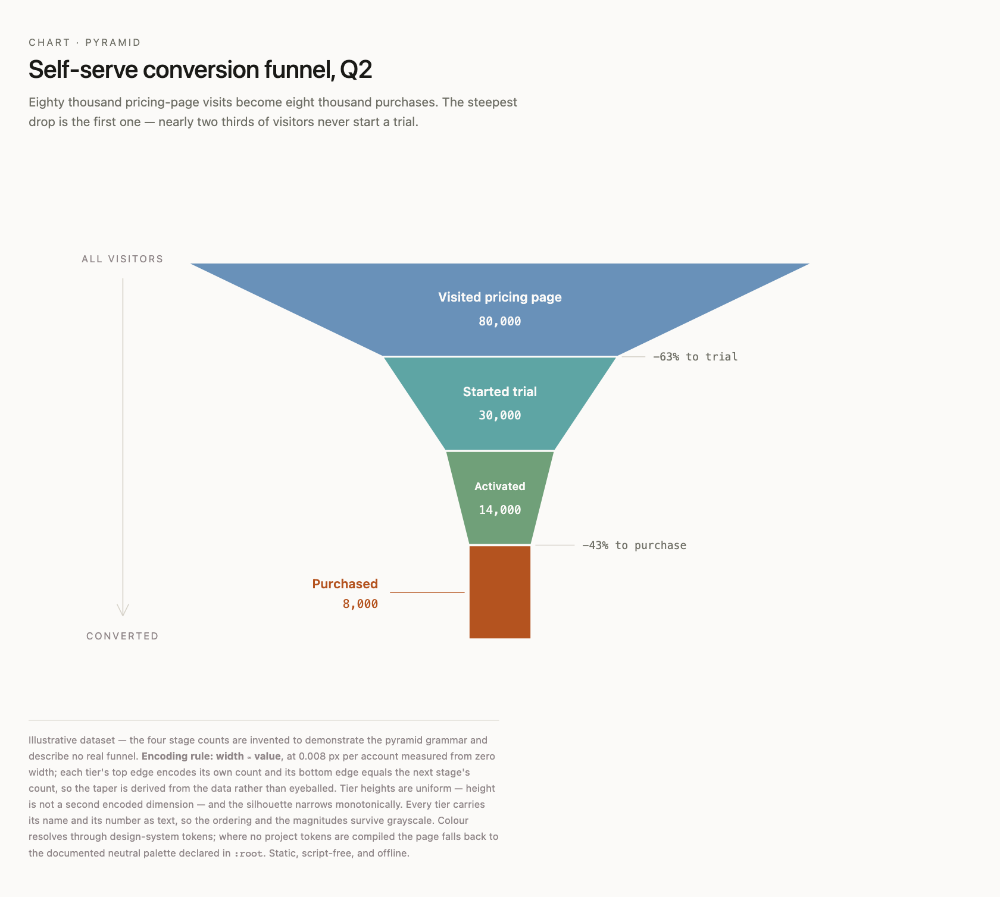</picture></a><br><sub><b>pyramid</b></sub></td>
<td width="33%"><a href="https://jangtrinh.github.io/design-os/examples/charts/radar.html" title="Streaming engine capability profiles — open the live artifact"><picture><source media="(prefers-color-scheme: dark)" srcset="docs/images/examples/charts/radar-dark.png">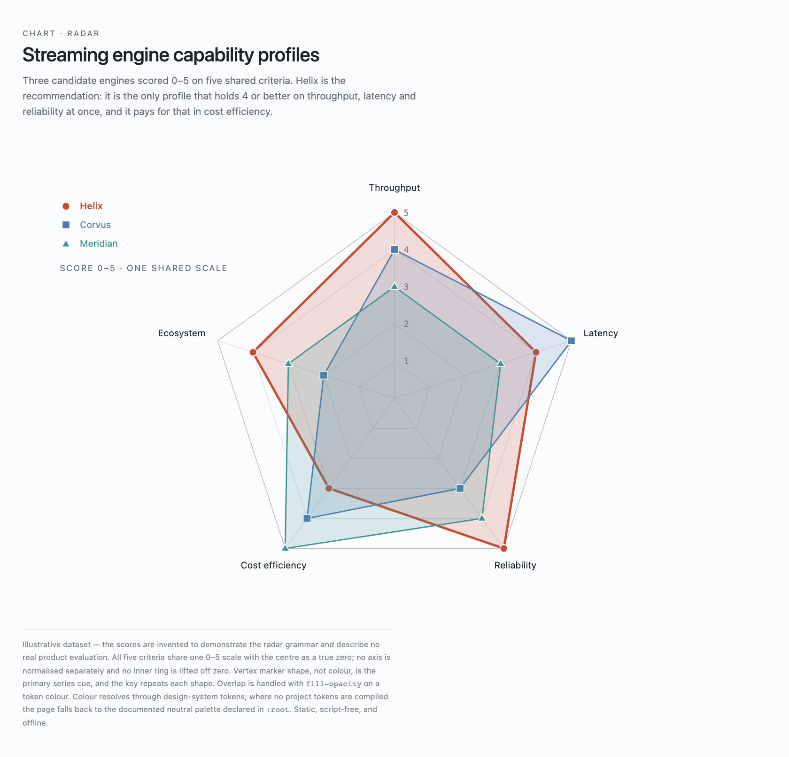</picture></a><br><sub><b>radar</b></sub></td>
</tr>
<tr>
<td width="33%"><a href="https://jangtrinh.github.io/design-os/examples/charts/scatter.html" title="Response time against request size — open the live artifact"><picture><source media="(prefers-color-scheme: dark)" srcset="docs/images/examples/charts/scatter-dark.png">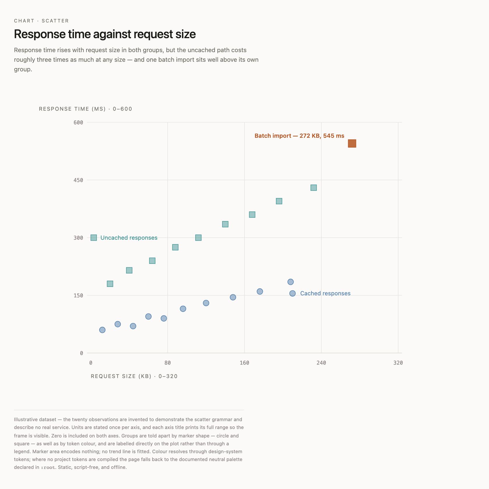</picture></a><br><sub><b>scatter</b></sub></td>
<td width="33%"><a href="https://jangtrinh.github.io/design-os/examples/charts/timeline.html" title="Release history, 2025 — open the live artifact"><picture><source media="(prefers-color-scheme: dark)" srcset="docs/images/examples/charts/timeline-dark.png">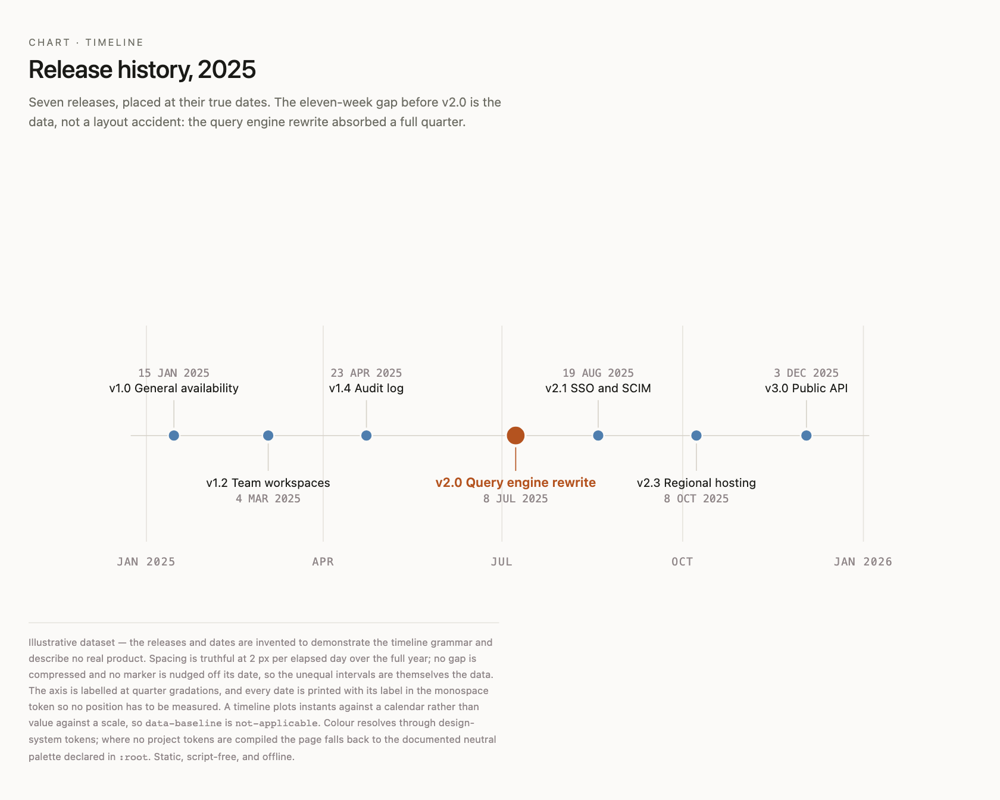</picture></a><br><sub><b>timeline</b></sub></td>
<td width="33%"><a href="https://jangtrinh.github.io/design-os/examples/charts/venn.html" title="Overlap between three workspace roles — open the live artifact"><picture><source media="(prefers-color-scheme: dark)" srcset="docs/images/examples/charts/venn-dark.png">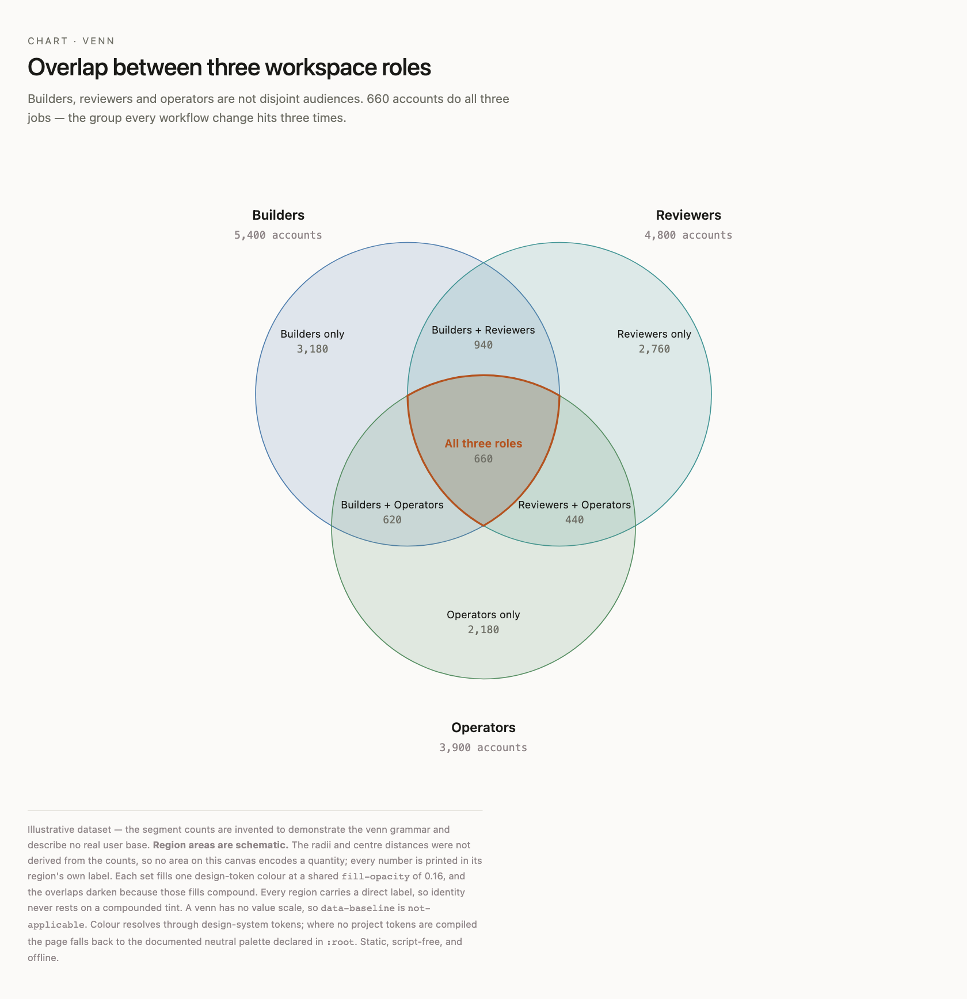</picture></a><br><sub><b>venn</b></sub></td>
</tr>
</table>

</details>

<!-- END:examples-grid -->

---

## Installation

Choose the setup that matches your AI coding agent. Every option installs the same canonical skill (`skills/design-os/SKILL.md`) and `/doctor` diagnostic suite.

### Claude Code

Run these two commands inside Claude Code:

```text
/plugin marketplace add jangtrinh/design-os
/plugin install design-os@design-os
```

### OpenAI Codex

Install to your personal Codex skills directory:

```bash
git clone https://github.com/jangtrinh/design-os.git /tmp/design-os
mkdir -p ~/.codex/skills/design-os ~/.codex/prompts
cp -R /tmp/design-os/skills/design-os/* ~/.codex/skills/design-os/
cp /tmp/design-os/prompts/doctor.md ~/.codex/prompts/design-os-doctor.md
rm -rf /tmp/design-os
```

### Gemini CLI & Google Antigravity

```bash
git clone https://github.com/jangtrinh/design-os.git /tmp/design-os
mkdir -p ~/.gemini/skills/design-os
cp -R /tmp/design-os/skills/design-os/* ~/.gemini/skills/design-os/
rm -rf /tmp/design-os
```

### OpenCode, Cursor, Windsurf & Other Agent Harnesses

```bash
git clone https://github.com/jangtrinh/design-os.git /tmp/design-os
mkdir -p ~/.agents/skills/design-os
cp -R /tmp/design-os/skills/design-os/* ~/.agents/skills/design-os/
rm -rf /tmp/design-os
```

<details>
<summary>Verify or uninstall</summary>

**Verify installation:**

```bash
python3 scripts/self_check.py
```

Or run `/doctor` inside Claude Code / Codex to inspect installed skill paths, plugin manifests, and gate health.

**Uninstall:**

```bash
rm -rf ~/.claude/skills/design-os ~/.codex/skills/design-os ~/.gemini/skills/design-os ~/.agents/skills/design-os
```

</details>

---

## Usage & Prompt Cookbook

Once installed, `skills/design-os/SKILL.md` activates automatically when your prompt matches its domain triggers. Browse [`docs/cookbook.md`](docs/cookbook.md) for copy-paste prompt recipes.

**Generate & Scaffold**

```text
"Initialize DESIGN:OS in this repo and wire our design tokens and verification gates for Claude Code and Codex."
```

**Audit & Verify**

```text
"Audit our current frontend components against DESIGN:OS typography, spacing, and WCAG 2.2 AA contrast gates."
```

**Export & Automate**

```text
"Scaffold a new product landing page with 2:1 axonometric B&W technical illustrations and SEO/AEO/GEO metadata."
```

---

## Commands & Diagnostics

| Command | Environment | What it does |
| :--- | :--- | :--- |
| `/doctor` | Claude Code / Codex | Read-only diagnostic check of installed skill paths, plugin manifests, and runtime prerequisites |
| `python3 scripts/self_check.py` | Terminal / CI | Deterministic offline verification of manifests, skill contracts, and governance files |
| `npx @easestart/design-os doctor` | Terminal / CI | Inspect active runtime adapters (Claude Code, Codex, Gemini CLI, Antigravity) and installed skill packs |
| `ui taste-lint` — 34 absolute checks | Terminal / CI | Generated-UI taste checks across motion, typography, spacing, and focus states |
| `ui validate-layout` — 20 checks | Terminal / CI | Structural and overflow safety checks (`100vw` traps, unclosed tags, sticky overflow) |
| `ui content-lint` — 12 checks | Terminal / CI | Honest copy checks (placeholder text, lorem-ipsum, generic names, all-caps shouting) |
| `ui tell-lint` — 43 checks, any language | Terminal / CI | Polyglot design-tell checks across HTML, JSX/TSX, Vue, Svelte, CSS, SwiftUI, and Flutter |
| `ui ds guidelines build \| check \| export --target figma` | Terminal / CI | Compile a cited guidelines pack from your sealed design system, rulings and glossary; lint it; export a ready-to-upload Figma library guidelines bundle |

---

## How it works

1. **Intent Routing** — Your AI agent matches your request against `skills/design-os/SKILL.md` frontmatter triggers.
2. **Progressive Context Loading** — Only the entry-point `SKILL.md` router loads initially; detailed recipes and scripts load on demand.
3. **Deterministic Execution** — Domain scripts and contracts execute locally with reproducible inputs and outputs.
4. **Gate Verification** — `scripts/self_check.py` and domain verifiers (`npx @easestart/design-os init`) validate the artifact before completion.
5. **Zero-Telemetry Delivery** — Verified files are written directly to your workspace with zero external network calls.

```text
User Prompt / CLI Invocation
            │
            ▼
┌───────────────────────────────────────────────┐
│ skills/design-os/SKILL.md
│ Progressive disclosure router & hard rules    │
└───────────┬───────────────────────────────────┘
            │ loads on demand
            ▼
┌───────────────────────────────────────────────┐
│ npx @easestart/design-os doctor
│ Deterministic build & contract enforcement    │
└───────────┬───────────────────────────────────┘
            │ verifies
            ▼
┌───────────────────────────────────────────────┐
│ python3 scripts/self_check.py + /doctor       │
│ Zero-telemetry local verification gate        │
└───────────────────────────────────────────────┘
```

### What loads when

`design-os` uses progressive context disclosure so your agent's context window stays fast and focused:

| File | Loaded when |
| :--- | :--- |
| `skills/design-os/SKILL.md` | Always (~100–150 lines) — routing rules, triggers, and execution workflow |
| `docs/cookbook.md` | When selecting multi-step prompt recipes or domain patterns |
| `commands/doctor.md` / `prompts/doctor.md` | Only when running `/doctor` diagnostics |
| `llms.txt` | When indexed by AI answer engines, RAG pipelines, or repo crawlers |

---

## File structure

```text
design-os/
├── .claude-plugin/
│   ├── plugin.json                 # Claude Code plugin manifest
│   └── marketplace.json            # Claude Code marketplace catalog
├── .codex-plugin/
│   └── plugin.json                 # OpenAI Codex plugin & interface manifest
├── .agents/
│   └── plugins/marketplace.json    # Cross-agent local plugin registry
├── .factory-plugin/
│   ├── plugin.json                 # Factory / Droid plugin manifest
│   └── marketplace.json            # Factory marketplace metadata
├── skills/
│   └── design-os/
│       └── SKILL.md                # Canonical agent skill entrypoint
├── commands/
│   └── doctor.md                   # /doctor diagnostic slash command
├── prompts/
│   └── doctor.md                   # Codex diagnostic prompt mirror
├── scripts/
│   └── self_check.py               # Deterministic repository & skill self-check
├── docs/
│   ├── cookbook.md                 # Copy-paste prompt recipes by job
│   └── llms.txt                    # GEO / LLM discovery index
├── PRIVACY.md                      # Zero-telemetry & local-first privacy commitment
├── SECURITY.md                     # Vulnerability disclosure & security policy
├── CONTRIBUTING.md                 # Contribution workflow & verification rules
├── CODE_OF_CONDUCT.md              # Contributor Covenant code of conduct
├── CHANGELOG.md                    # Release history
├── llms.txt                        # Root LLM indexing manifest
├── LICENSE                         # MIT License
└── README.md
```

---

## Quality bar & Limitations

### It's working if...

- `python3 scripts/self_check.py` prints `ok: design-os self-check passed (design-os)` and exits `0`.
- `npx @easestart/design-os init` passes with zero contract or test regressions.
- Your AI coding agent loads `skills/design-os/SKILL.md` automatically when given any prompt from [`docs/cookbook.md`](docs/cookbook.md).
- Network traffic during execution remains zero (guaranteed by [`PRIVACY.md`](PRIVACY.md)).

### When not to use

- Throwaway backend scripts with zero user-facing UI, CLI, or documentation surface.
- Teams looking for a hosted cloud SaaS design tool rather than a local-first, git-tracked engineering toolchain.
- Replacing human brand strategy — DESIGN:OS enforces and scales design systems, not customer discovery.

---

## DESIGN:OS Ecosystem

`design-os` is one of the 13 open-source engines in the **`DESIGN:OS`** ecosystem:

| Engine | Live Docs | Repository | Layer |
| :--- | :--- | :--- | :--- |
| **DESIGN:OS CLI** | [jangtrinh.github.io/design-os](https://jangtrinh.github.io/design-os/) | [`jangtrinh/design-os`](https://github.com/jangtrinh/design-os) | `cli` |
| **Knowledge Builder** | [jangtrinh.github.io/design-os-knowledge-builder](https://jangtrinh.github.io/design-os-knowledge-builder/) | [`jangtrinh/design-os-knowledge-builder`](https://github.com/jangtrinh/design-os-knowledge-builder) | `compiler` |
| **Figma Plugin & CLI** | [jangtrinh.github.io/design-os-figma-plugin](https://jangtrinh.github.io/design-os-figma-plugin/) | [`jangtrinh/design-os-figma-plugin`](https://github.com/jangtrinh/design-os-figma-plugin) | `plugin` |
| **SVG Animation Engine** | [jangtrinh.github.io/design-os-svg-animation](https://jangtrinh.github.io/design-os-svg-animation/) | [`jangtrinh/design-os-svg-animation`](https://github.com/jangtrinh/design-os-svg-animation) | `engine` |
| **3D Blender Agent** | [jangtrinh.github.io/design-os-3d-blender](https://jangtrinh.github.io/design-os-3d-blender/) | [`jangtrinh/design-os-3d-blender`](https://github.com/jangtrinh/design-os-3d-blender) | `3d / cad` |
| **OPAH ONE Drone** | [jangtrinh.github.io/design-os-drone-showcase](https://jangtrinh.github.io/design-os-drone-showcase/) | [`jangtrinh/design-os-drone-showcase`](https://github.com/jangtrinh/design-os-drone-showcase) | `hardware` |
| **GitHub Pages Engine** | [jangtrinh.github.io/design-os-github-page](https://jangtrinh.github.io/design-os-github-page/) | [`jangtrinh/design-os-github-page`](https://github.com/jangtrinh/design-os-github-page) | `pages` |
| **Apple Design OS** | [jangtrinh.github.io/design-os-apple](https://jangtrinh.github.io/design-os-apple/) | [`jangtrinh/design-os-apple`](https://github.com/jangtrinh/design-os-apple) | `swiftui` |
| **Agent Teacher** | [jangtrinh.github.io/design-os-pedagogy](https://jangtrinh.github.io/design-os-pedagogy/) | [`jangtrinh/design-os-pedagogy`](https://github.com/jangtrinh/design-os-pedagogy) | `pedagogy` |
| **Origami CAD** | [jangtrinh.github.io/design-os-origami](https://jangtrinh.github.io/design-os-origami/) | [`jangtrinh/design-os-origami`](https://github.com/jangtrinh/design-os-origami) | `packaging` |
| **Voice UX Architecture** | [jangtrinh.github.io/design-os-voice-ux](https://jangtrinh.github.io/design-os-voice-ux/) | [`jangtrinh/design-os-voice-ux`](https://github.com/jangtrinh/design-os-voice-ux) | `voice-ai` |
| **Code2Flow** | [jangtrinh.github.io/design-os-code2flow](https://jangtrinh.github.io/design-os-code2flow/) | [`jangtrinh/design-os-code2flow`](https://github.com/jangtrinh/design-os-code2flow) | `ast / audit` |
| **Generative UI** | [jangtrinh.github.io/design-os-generative-ui](https://jangtrinh.github.io/design-os-generative-ui/) | [`jangtrinh/design-os-generative-ui`](https://github.com/jangtrinh/design-os-generative-ui) | `runtime` |

---

## Contributing, Governance & License

- **Contributing**: See [`CONTRIBUTING.md`](CONTRIBUTING.md) for pull request guidelines and verification gates (`python3 scripts/self_check.py`).
- **Code of Conduct**: Governed by [`CODE_OF_CONDUCT.md`](CODE_OF_CONDUCT.md).
- **Security & Privacy**: Zero telemetry — see [`SECURITY.md`](SECURITY.md) and [`PRIVACY.md`](PRIVACY.md).
- **Changelog & LLM Index**: Track releases in [`CHANGELOG.md`](CHANGELOG.md) and machine-readable index in [`llms.txt`](llms.txt).
- **License**: [MIT](LICENSE) © [Jang Trinh](https://github.com/jangtrinh).

---

If `design-os` saves you time, a star on GitHub helps other engineers and AI agents find it.

<p align="left">
  <a href="https://buymeacoffee.com/jangtrinh">
    
  </a>
</p>
