# DESIGN:OS CLI

<p>
<picture>
  <source media="(prefers-color-scheme: dark)" srcset="assets/readme/cover-dark.png">
  <source media="(prefers-color-scheme: light)" srcset="assets/readme/cover-light.png">
  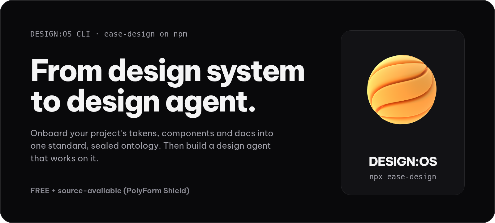
</picture>
</p>

**Onboard your project's design system into one standard ontology, then build an autonomous design agent on it.**

DESIGN:OS CLI reads the tokens, components and docs your project already has and compiles them into a sealed `design/` store: DTCG tokens with modes, a component registry, a declared stance and a hash-sealed manifest. Your coding agent (Claude Code, Codex or Antigravity) then loads that store before every task, works with the project's own names and values, and runs deterministic gates on what it makes. The CLI itself never calls a model and sends nothing off your machine.

FREE + source-available ([PolyForm Shield 1.0.0](LICENSE)). Published on npm as [`ease-design`](https://www.npmjs.com/package/ease-design); the command is `ui`.

<p>
  <a href="#quickstart">Quickstart</a> · <a href="#how-it-works">How it works</a> · <a href="#commands">Commands</a> · <a href="#install-for-your-agent">Install for your agent</a> · <a href="#limits">Limits</a>
</p>

## Quickstart

Node 20 or later. Run these in your project:

```bash
npx ease-design scan                    # what design signals does this project have?
npx ease-design init --runtime claude   # or codex, antigravity, or --all
npx ease-design onboard                 # setup checklist and the next command to run
```

Onboard a CSS design system (custom properties) into the store:

```bash
npx ease-design designmd extract-tokens index.html --css styles.css --out extract.json
npx ease-design ingest-css-ds extract.json --out capture --name acme
npx ease-design ds import capture/tokens.json --dir . --name acme
npx ease-design ds context              # the block your agent loads first
```

Optional: generate Claude Code project agents bound to that store.

```bash
npx ease-design agents init             # designer, curator, figma-hand
```

To keep `ui` on your path: `npm install -g ease-design`.

## How it works

<p>
<picture>
  <source media="(prefers-color-scheme: dark)" srcset="assets/readme/flow-dark.png">
  <source media="(prefers-color-scheme: light)" srcset="assets/readme/flow-light.png">
  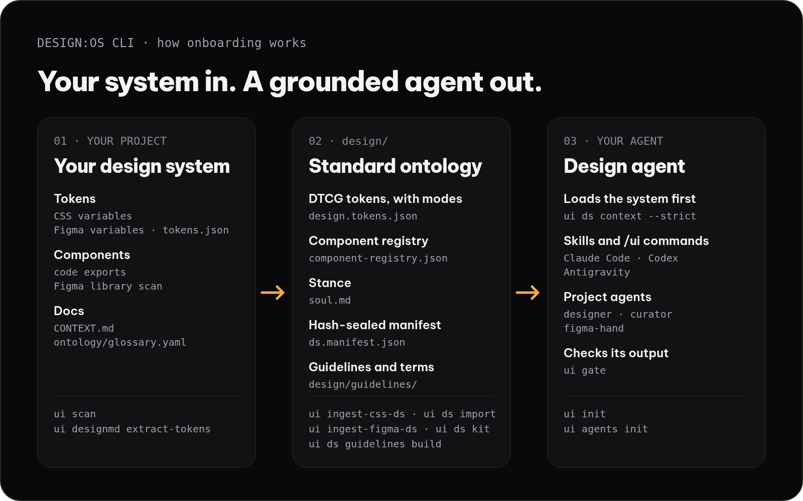
</picture>
</p>

**1. Your design system.** `ui scan` detects the framework, styling and component folders. Tokens come from CSS custom properties (`ui designmd extract-tokens`), a Figma library scan made with [Bridge](https://github.com/jangtrinh/design-os-figma-plugin), or a flat `tokens.json`. Components come from your code exports or the same Figma scan. `CONTEXT.md` and `ontology/glossary.yaml` supply the project's terms.

**2. The standard ontology.** Every source compiles into the same `design/` store:

| File | What it holds |
| :--- | :--- |
| `design.tokens.json` | W3C DTCG tokens: primitives, semantic aliases, Light and Dark modes |
| `component-registry.json` | Every component by its exact owner name, with variants, states and the tokens it uses |
| `soul.md` | The declared stance: what the system never does, always does, and how it speaks |
| `ds.manifest.json` | Generation, persona and the hashes that seal the store |
| `guidelines/` | A cited guidelines pack compiled from the store, rulings and glossary (`ui ds guidelines build`) |

`ui ingest-css-ds`, `ui ingest-figma-ds` and `ui ds import` write it; `ui ds kit plan | prepare | validate | adopt | verify` takes a full component kit from capture to a verified, adopted state. After that, tokens change through `ui ds change-token` and `ui ds set-role`. A hand edit breaks the seal: `ui ds status` and `ui ds context` report the hash mismatch until the change goes through the CLI or `ui ds reseal`.

**3. Your design agent.** `ui init` writes skills, `/ui` commands and routing rules for Claude Code, Antigravity or Codex. `ui agents init` adds three project agents named after your project (designer, curator, figma-hand), from one roster, for Claude Code, Codex and Antigravity. Each one loads `ui ds context` before it acts, and the designer looks up every component it uses with `ui registry lookup`, so it works from your tokens and components instead of defaults. `ui gate` checks what the agent builds: layout, accessibility, taste, tells, copy and design-system usage, in one verdict.

## Commands

| Command | What it does |
| :--- | :--- |
| `ui scan` · `ui onboard` | Detect existing design signals; show the setup checklist. Read-only |
| `ui ingest-css-ds` · `ui ingest-figma-ds` · `ui ds import` | Compile CSS variables, a Figma scan or a flat `tokens.json` into the `design/` store |
| `ui ds kit` | Plan, prepare, validate, adopt and verify a complete component kit |
| `ui ds context` | Emit the active design system as the context block for your agent |
| `ui ds status` · `ui ds diff` · `ui ds a11y` | Manifest summary; semver-classified diff between two states; token contrast audit |
| `ui ds guidelines build \| check \| export` | Compile, lint and export the guidelines pack |
| `ui init` · `ui agents init` | Write the runtime adapters; generate project agents |
| `ui gate` | Composed floor judge over every linter family: layout, a11y, taste, tell, content, ds-usage |
| `ui taste-lint` — 35 absolute checks | Generated-UI taste floor: motion, typography, spacing and focus states |
| `ui validate-layout` — 20 checks | Structure and overflow safety (`100vw` traps, unclosed tags, sticky overflow) |
| `ui content-lint` — 15 checks | Honest copy: placeholder text, lorem ipsum, generic names, all-caps shouting |
| `ui tell-lint` — 43 checks, any language | Design tells across HTML, JSX/TSX, Vue, Svelte, CSS, SwiftUI and Flutter |
| `ui tokens` · `ui color` | Compile DTCG tokens to CSS, Tailwind or Figma variables; OKLCH colour math |
| `ui doctor` | Check that the install and the project are healthy |

`ui --help` lists all commands; `ui schema --json` emits machine-readable signatures for every one.

## Install for your agent

`ui init` above wires a project. To install the skill itself:

**Claude Code**

```text
/plugin marketplace add jangtrinh/design-os
/plugin install design-os@design-os
```

**Codex**

```bash
git clone https://github.com/jangtrinh/design-os.git /tmp/design-os
mkdir -p ~/.codex/skills/design-os ~/.codex/prompts
cp -R /tmp/design-os/skills/design-os/* ~/.codex/skills/design-os/
cp /tmp/design-os/prompts/doctor.md ~/.codex/prompts/design-os-doctor.md
rm -rf /tmp/design-os
```

**Gemini CLI and Antigravity**

```bash
git clone https://github.com/jangtrinh/design-os.git /tmp/design-os
mkdir -p ~/.gemini/skills/design-os
cp -R /tmp/design-os/skills/design-os/* ~/.gemini/skills/design-os/
rm -rf /tmp/design-os
```

**Other harnesses (OpenCode, Cursor, Windsurf)**

```bash
git clone https://github.com/jangtrinh/design-os.git /tmp/design-os
mkdir -p ~/.agents/skills/design-os
cp -R /tmp/design-os/skills/design-os/* ~/.agents/skills/design-os/
rm -rf /tmp/design-os
```

Check a clone of this repository with `python3 scripts/self_check.py`, or run `/doctor` in Claude Code or Codex.

## Examples

Diagrams and charts built with the CLI. Each one is a committed artifact that passes its linter with zero findings.

<!-- BEGIN:examples-grid (generated by scripts/build-examples-gallery.mjs) -->

<table>
<tr>
<td width="50%"><a href="https://jangtrinh.github.io/design-os/examples/diagrams/architecture.html" title="Three-tier web application — open the live artifact"><picture><source media="(prefers-color-scheme: dark)" srcset="docs/images/examples/diagrams/architecture-dark.png">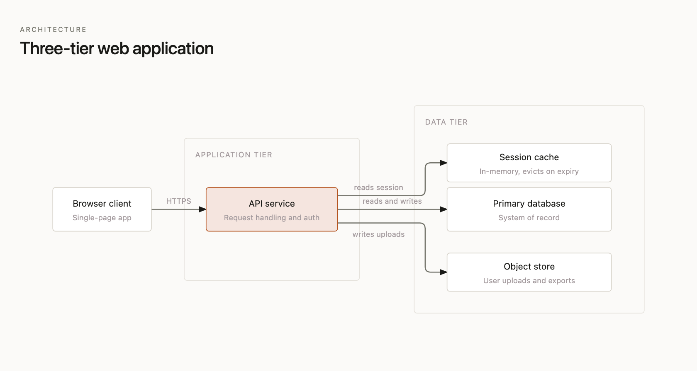</picture></a><br><sub><b>architecture</b> — Three-tier web application</sub></td>
<td width="50%"><a href="https://jangtrinh.github.io/design-os/examples/diagrams/medallion.html" title="Survey dataset storage tiers — open the live artifact"><picture><source media="(prefers-color-scheme: dark)" srcset="docs/images/examples/diagrams/medallion-dark.png">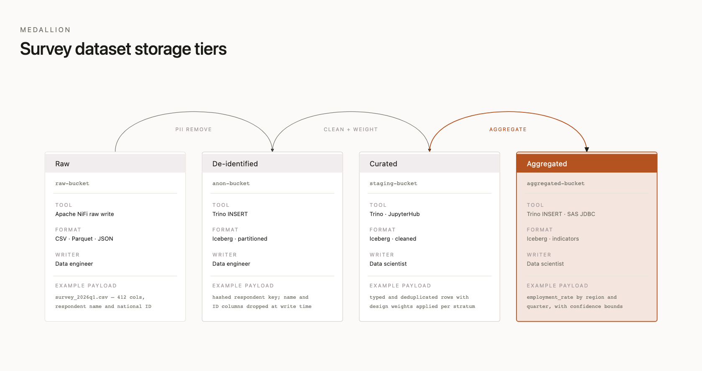</picture></a><br><sub><b>medallion</b> — Survey dataset storage tiers</sub></td>
</tr>
<tr>
<td width="50%"><a href="https://jangtrinh.github.io/design-os/examples/charts/bar.html" title="Revenue by region, FY2025 — open the live artifact"><picture><source media="(prefers-color-scheme: dark)" srcset="docs/images/examples/charts/bar-dark.png">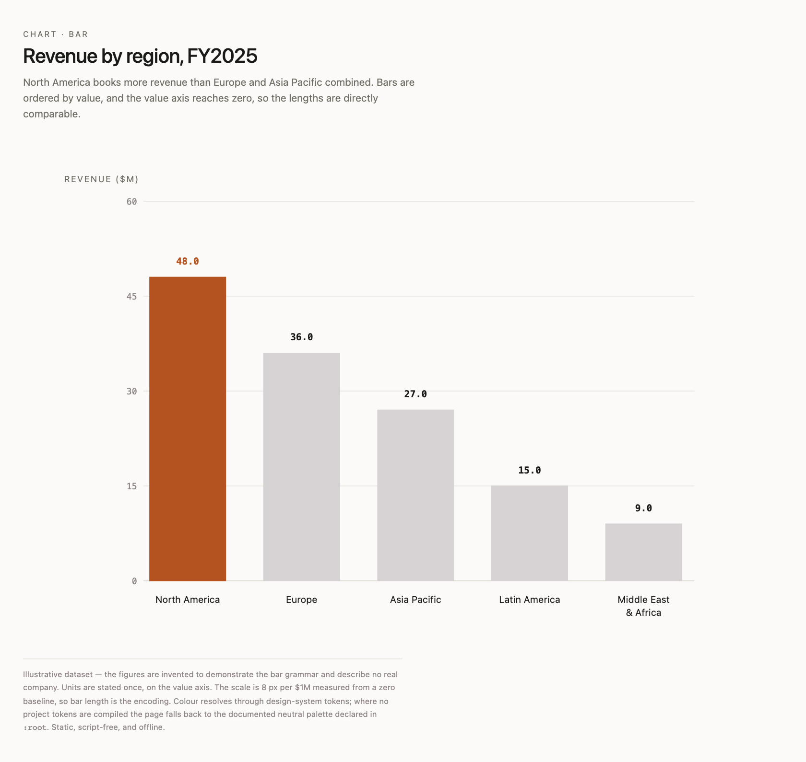</picture></a><br><sub><b>bar</b> — Revenue by region, FY2025</sub></td>
<td width="50%"><a href="https://jangtrinh.github.io/design-os/examples/charts/quadrant.html" title="Q3 initiatives by effort and impact — open the live artifact"><picture><source media="(prefers-color-scheme: dark)" srcset="docs/images/examples/charts/quadrant-dark.png">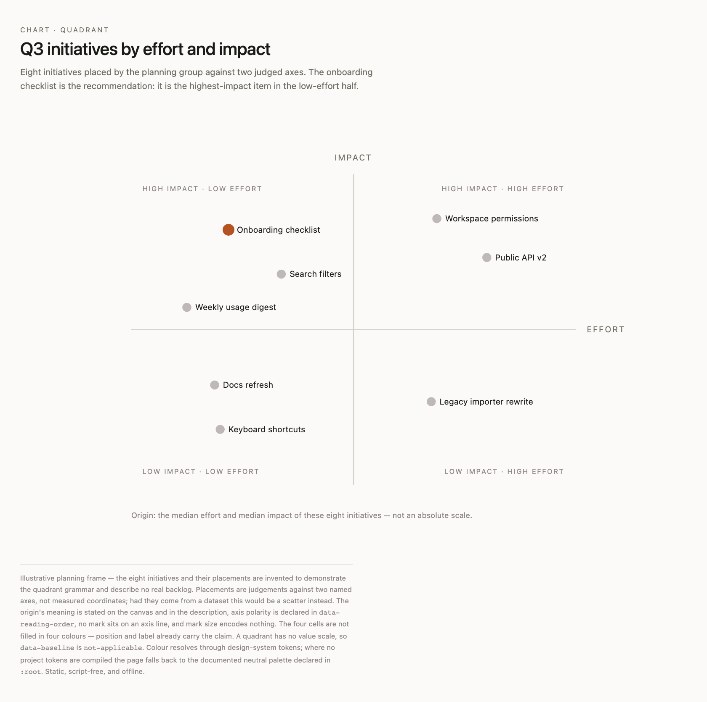</picture></a><br><sub><b>quadrant</b> — Q3 initiatives by effort and impact</sub></td>
</tr>
</table>

<details>
<summary><b>All 28 grammars rendered</b> — every one of these is a committed artifact that passes its linter with zero findings</summary>

<table>
<tr>
<td width="33%"><a href="https://jangtrinh.github.io/design-os/examples/diagrams/data-flow.html" title="Nightly reporting run — open the live artifact"><picture><source media="(prefers-color-scheme: dark)" srcset="docs/images/examples/diagrams/data-flow-dark.png">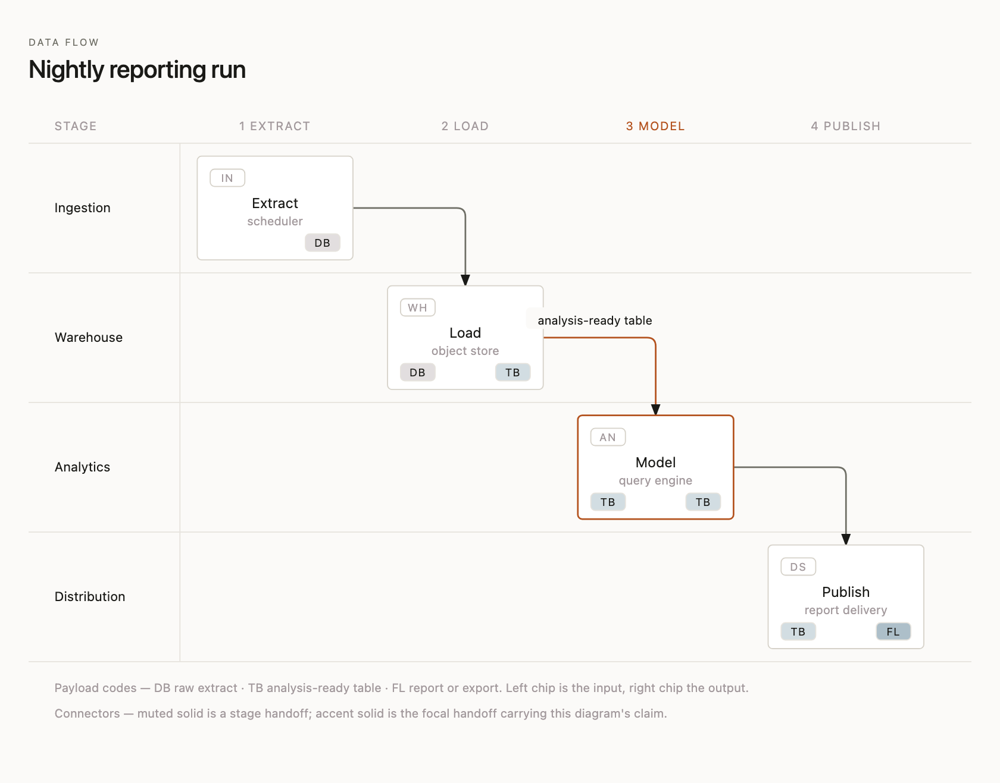</picture></a><br><sub><b>data-flow</b></sub></td>
<td width="33%"><a href="https://jangtrinh.github.io/design-os/examples/diagrams/dp-integration.html" title="Data platform integration surfaces — open the live artifact"><picture><source media="(prefers-color-scheme: dark)" srcset="docs/images/examples/diagrams/dp-integration-dark.png">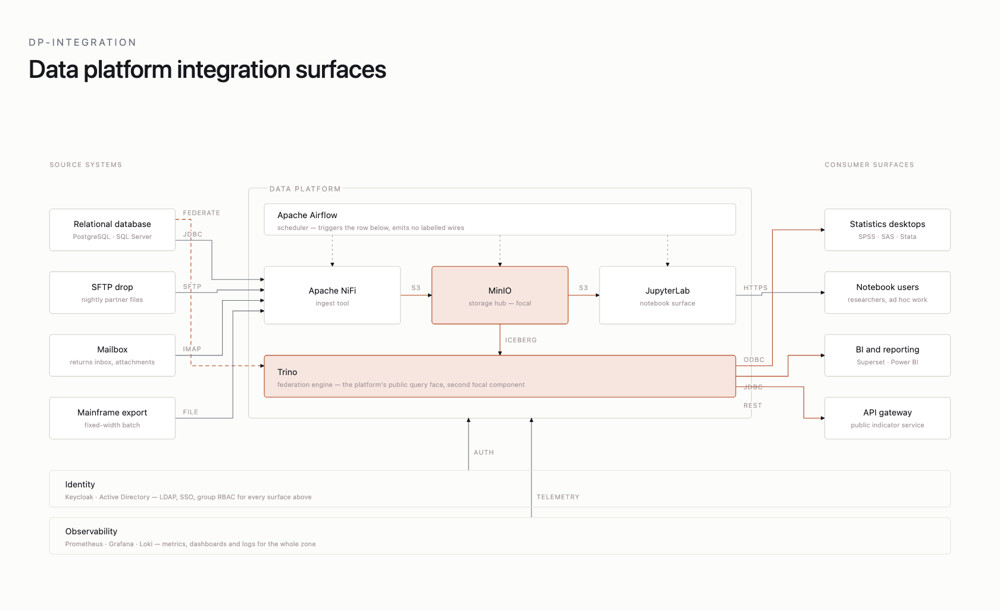</picture></a><br><sub><b>dp-integration</b></sub></td>
<td width="33%"><a href="https://jangtrinh.github.io/design-os/examples/diagrams/dp-security-matrix.html" title="Platform entitlement matrix — open the live artifact"><picture><source media="(prefers-color-scheme: dark)" srcset="docs/images/examples/diagrams/dp-security-matrix-dark.png">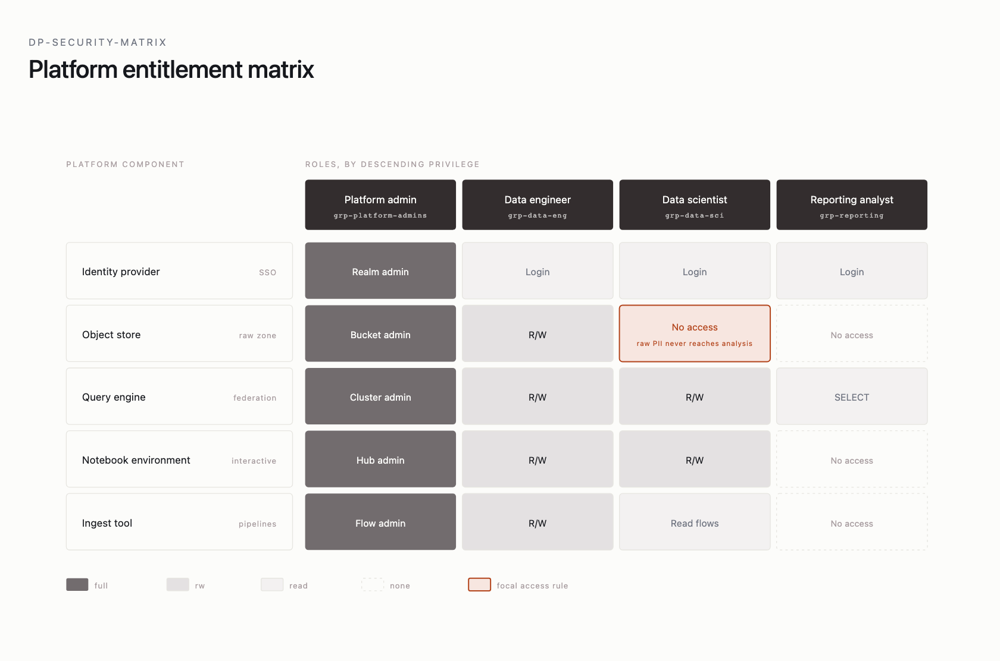</picture></a><br><sub><b>dp-security-matrix</b></sub></td>
</tr>
<tr>
<td width="33%"><a href="https://jangtrinh.github.io/design-os/examples/diagrams/er.html" title="Order model — open the live artifact"><picture><source media="(prefers-color-scheme: dark)" srcset="docs/images/examples/diagrams/er-dark.png">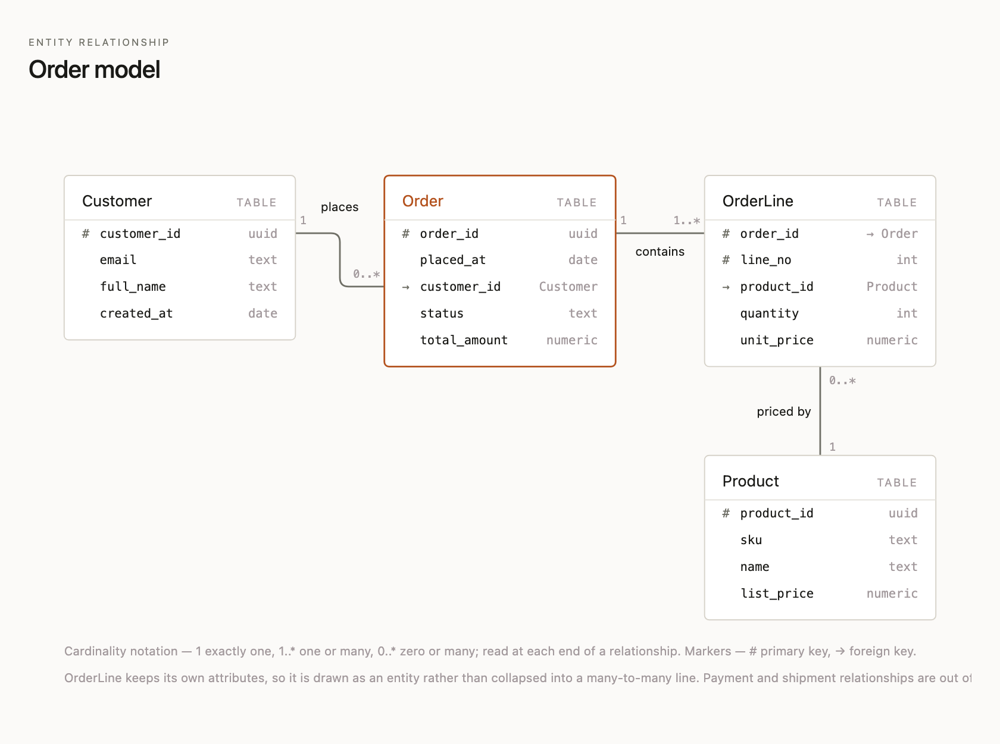</picture></a><br><sub><b>er</b></sub></td>
<td width="33%"><a href="https://jangtrinh.github.io/design-os/examples/diagrams/flowchart.html" title="Loan eligibility check — open the live artifact"><picture><source media="(prefers-color-scheme: dark)" srcset="docs/images/examples/diagrams/flowchart-dark.png">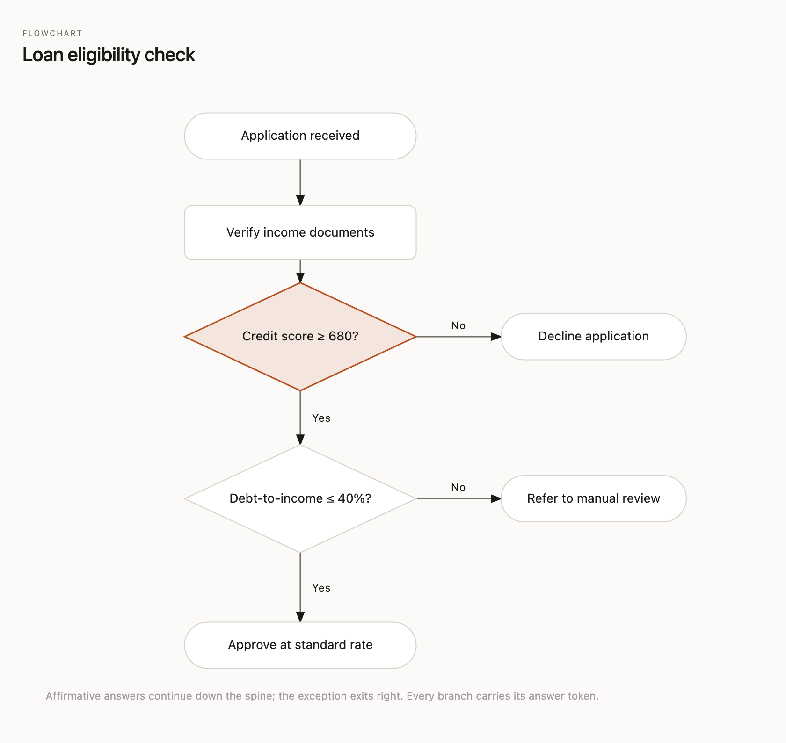</picture></a><br><sub><b>flowchart</b></sub></td>
<td width="33%"><a href="https://jangtrinh.github.io/design-os/examples/diagrams/high-level.html" title="Lakehouse capability sweep — open the live artifact"><picture><source media="(prefers-color-scheme: dark)" srcset="docs/images/examples/diagrams/high-level-dark.png">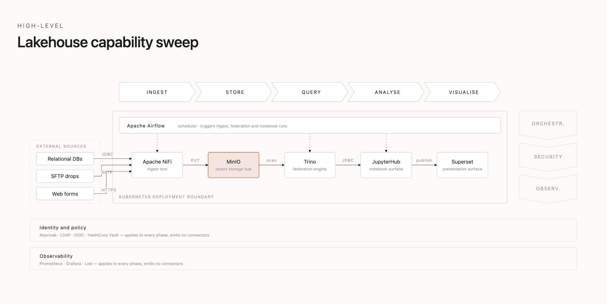</picture></a><br><sub><b>high-level</b></sub></td>
</tr>
<tr>
<td width="33%"><a href="https://jangtrinh.github.io/design-os/examples/diagrams/it-state.html" title="Statistics estate before modernisation — open the live artifact"><picture><source media="(prefers-color-scheme: dark)" srcset="docs/images/examples/diagrams/it-state-dark.png">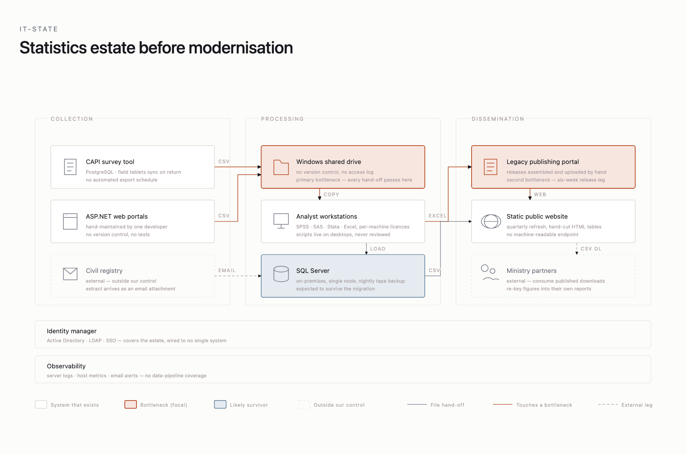</picture></a><br><sub><b>it-state</b></sub></td>
<td width="33%"><a href="https://jangtrinh.github.io/design-os/examples/diagrams/layers.html" title="Runtime stack, hardware upward — open the live artifact"><picture><source media="(prefers-color-scheme: dark)" srcset="docs/images/examples/diagrams/layers-dark.png">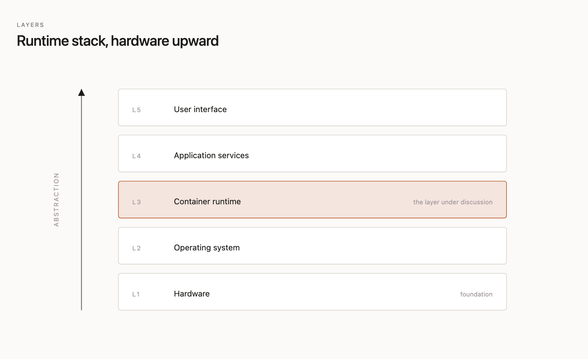</picture></a><br><sub><b>layers</b></sub></td>
<td width="33%"><a href="https://jangtrinh.github.io/design-os/examples/diagrams/loop.html" title="Platform operating cycle — open the live artifact"><picture><source media="(prefers-color-scheme: dark)" srcset="docs/images/examples/diagrams/loop-dark.png">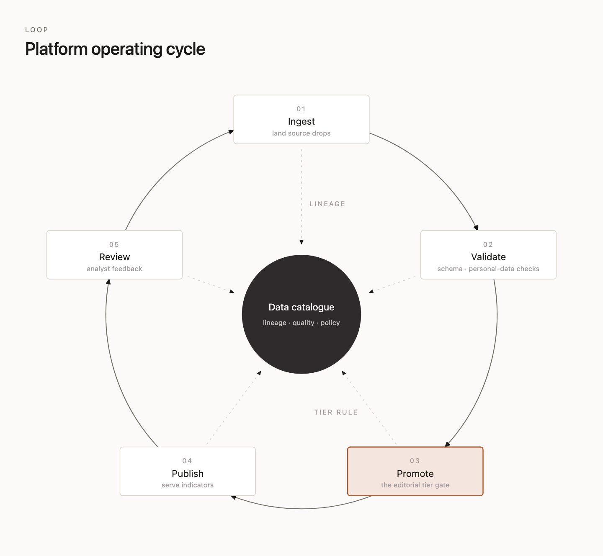</picture></a><br><sub><b>loop</b></sub></td>
</tr>
<tr>
<td width="33%"><a href="https://jangtrinh.github.io/design-os/examples/diagrams/nested.html" title="Trust zones, outside in — open the live artifact"><picture><source media="(prefers-color-scheme: dark)" srcset="docs/images/examples/diagrams/nested-dark.png">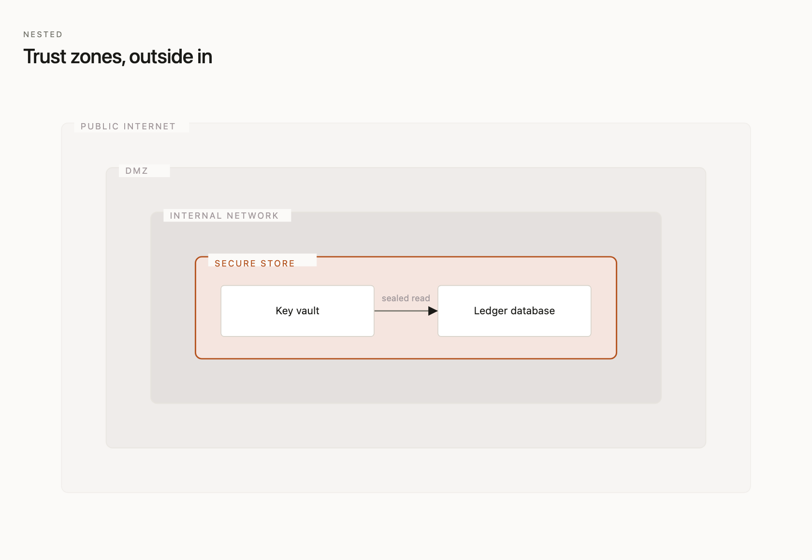</picture></a><br><sub><b>nested</b></sub></td>
<td width="33%"><a href="https://jangtrinh.github.io/design-os/examples/diagrams/org-chart.html" title="Engineering, who to reach — open the live artifact"><picture><source media="(prefers-color-scheme: dark)" srcset="docs/images/examples/diagrams/org-chart-dark.png">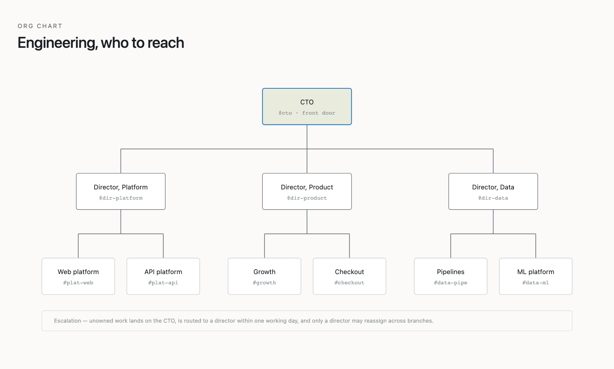</picture></a><br><sub><b>org-chart</b></sub></td>
<td width="33%"><a href="https://jangtrinh.github.io/design-os/examples/diagrams/process.html" title="Incident response runbook — open the live artifact"><picture><source media="(prefers-color-scheme: dark)" srcset="docs/images/examples/diagrams/process-dark.png">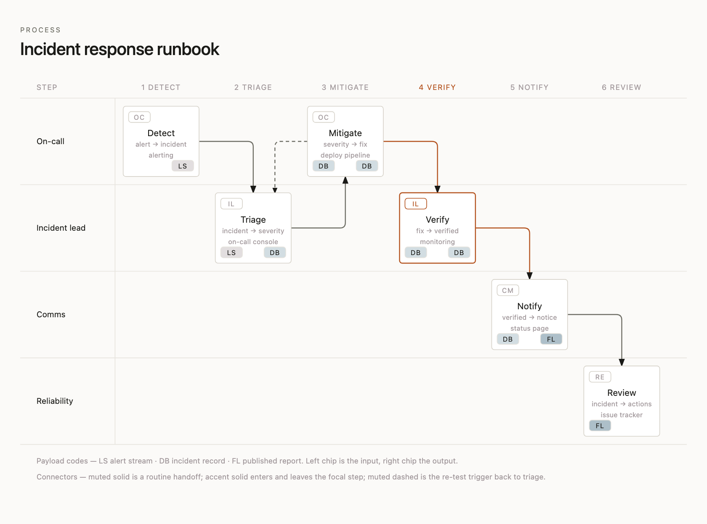</picture></a><br><sub><b>process</b></sub></td>
</tr>
<tr>
<td width="33%"><a href="https://jangtrinh.github.io/design-os/examples/diagrams/product-flow.html" title="Checkout flow, partial view — open the live artifact"><picture><source media="(prefers-color-scheme: dark)" srcset="docs/images/examples/diagrams/product-flow-dark.png">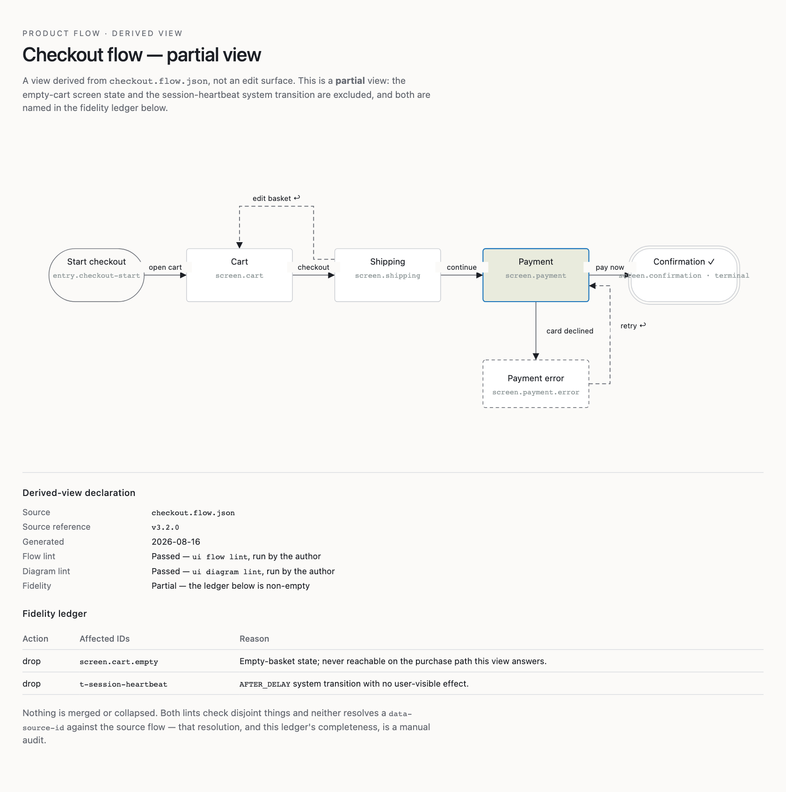</picture></a><br><sub><b>product-flow</b></sub></td>
<td width="33%"><a href="https://jangtrinh.github.io/design-os/examples/diagrams/sequence.html" title="User sign-in exchange — open the live artifact"><picture><source media="(prefers-color-scheme: dark)" srcset="docs/images/examples/diagrams/sequence-dark.png">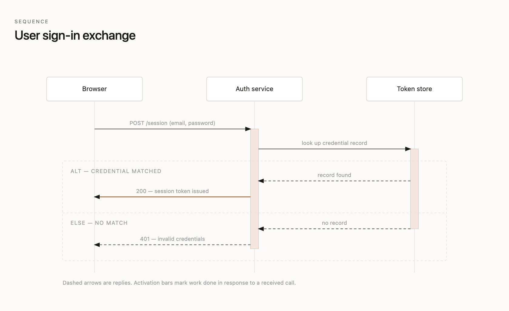</picture></a><br><sub><b>sequence</b></sub></td>
<td width="33%"><a href="https://jangtrinh.github.io/design-os/examples/diagrams/state.html" title="Subscription lifecycle — open the live artifact"><picture><source media="(prefers-color-scheme: dark)" srcset="docs/images/examples/diagrams/state-dark.png">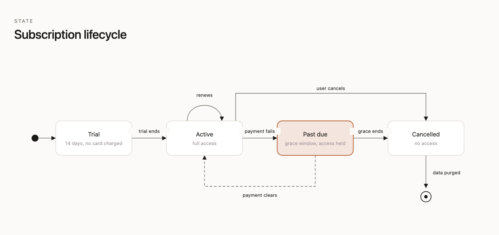</picture></a><br><sub><b>state</b></sub></td>
</tr>
<tr>
<td width="33%"><a href="https://jangtrinh.github.io/design-os/examples/diagrams/swimlane.html" title="Expense claim ownership — open the live artifact"><picture><source media="(prefers-color-scheme: dark)" srcset="docs/images/examples/diagrams/swimlane-dark.png">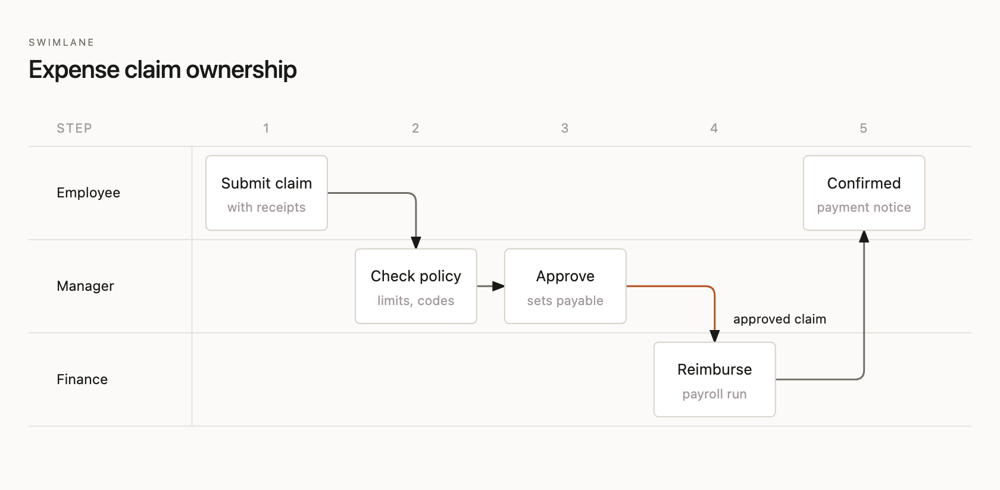</picture></a><br><sub><b>swimlane</b></sub></td>
<td width="33%"><a href="https://jangtrinh.github.io/design-os/examples/diagrams/tree.html" title="Catalogue taxonomy, root at the leading edge — open the live artifact"><picture><source media="(prefers-color-scheme: dark)" srcset="docs/images/examples/diagrams/tree-dark.png">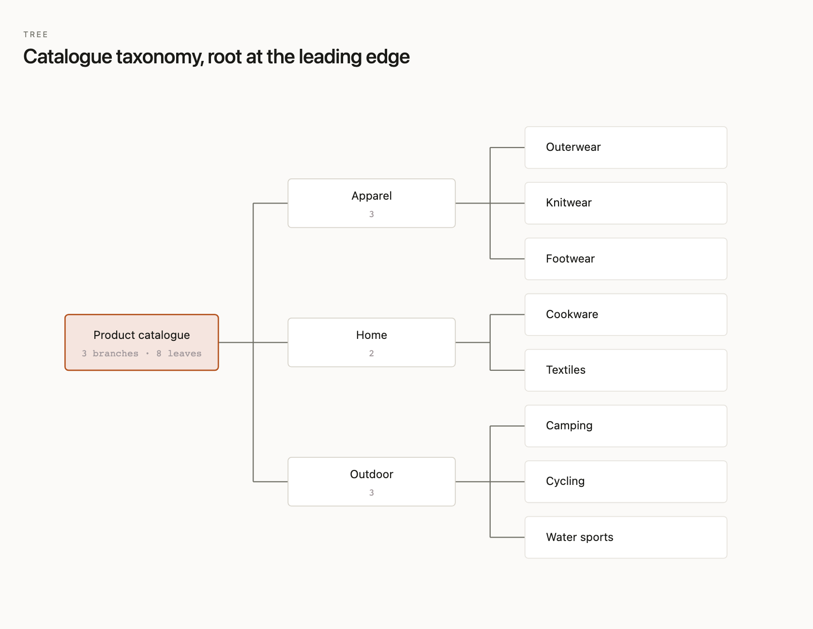</picture></a><br><sub><b>tree</b></sub></td>
<td width="33%"><a href="https://jangtrinh.github.io/design-os/examples/charts/gantt.html" title="Reporting platform plan, H1 2026 — open the live artifact"><picture><source media="(prefers-color-scheme: dark)" srcset="docs/images/examples/charts/gantt-dark.png">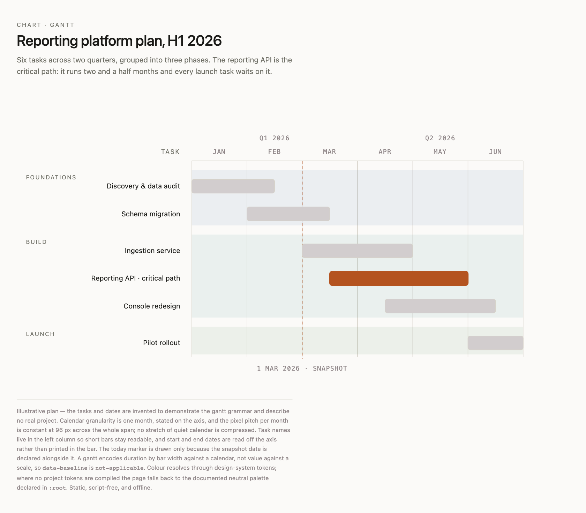</picture></a><br><sub><b>gantt</b></sub></td>
</tr>
<tr>
<td width="33%"><a href="https://jangtrinh.github.io/design-os/examples/charts/line.html" title="Monthly active users, 2025 — open the live artifact"><picture><source media="(prefers-color-scheme: dark)" srcset="docs/images/examples/charts/line-dark.png">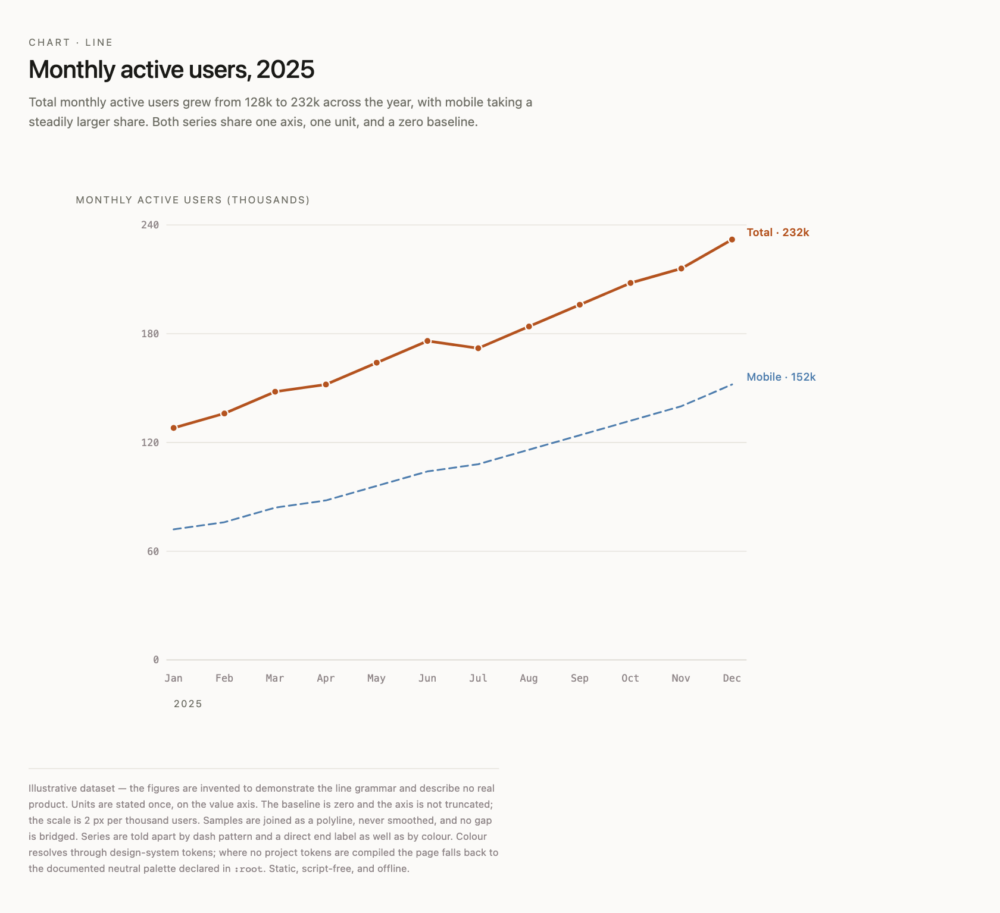</picture></a><br><sub><b>line</b></sub></td>
<td width="33%"><a href="https://jangtrinh.github.io/design-os/examples/charts/pyramid.html" title="Self-serve conversion funnel, Q2 — open the live artifact"><picture><source media="(prefers-color-scheme: dark)" srcset="docs/images/examples/charts/pyramid-dark.png">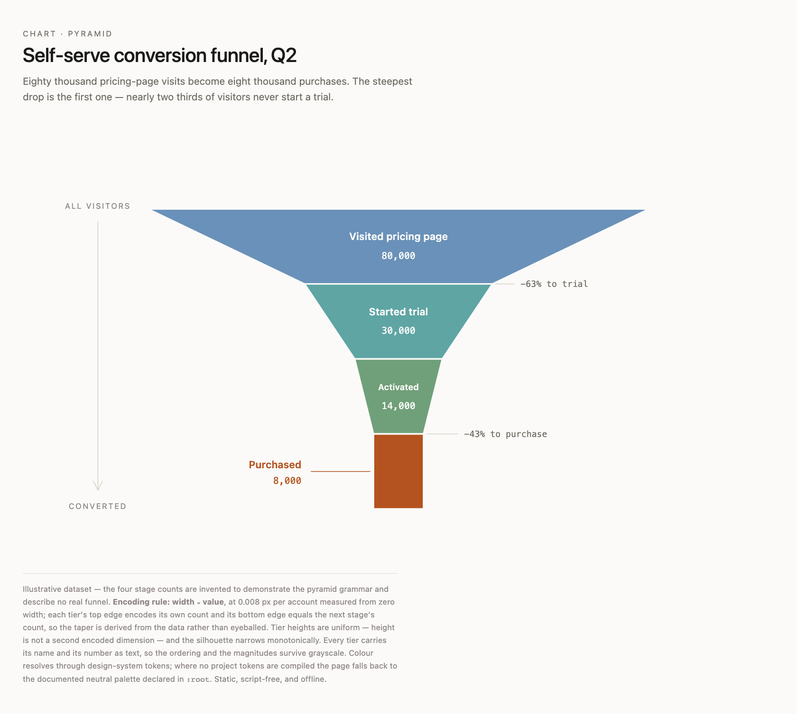</picture></a><br><sub><b>pyramid</b></sub></td>
<td width="33%"><a href="https://jangtrinh.github.io/design-os/examples/charts/radar.html" title="Streaming engine capability profiles — open the live artifact"><picture><source media="(prefers-color-scheme: dark)" srcset="docs/images/examples/charts/radar-dark.png">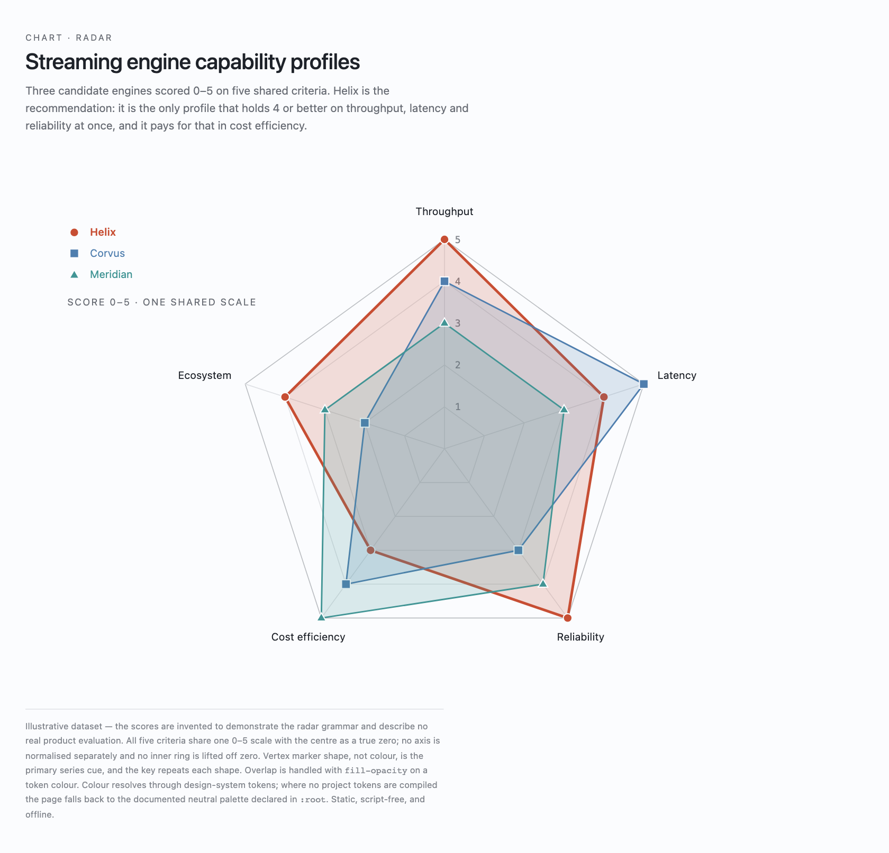</picture></a><br><sub><b>radar</b></sub></td>
</tr>
<tr>
<td width="33%"><a href="https://jangtrinh.github.io/design-os/examples/charts/scatter.html" title="Response time against request size — open the live artifact"><picture><source media="(prefers-color-scheme: dark)" srcset="docs/images/examples/charts/scatter-dark.png">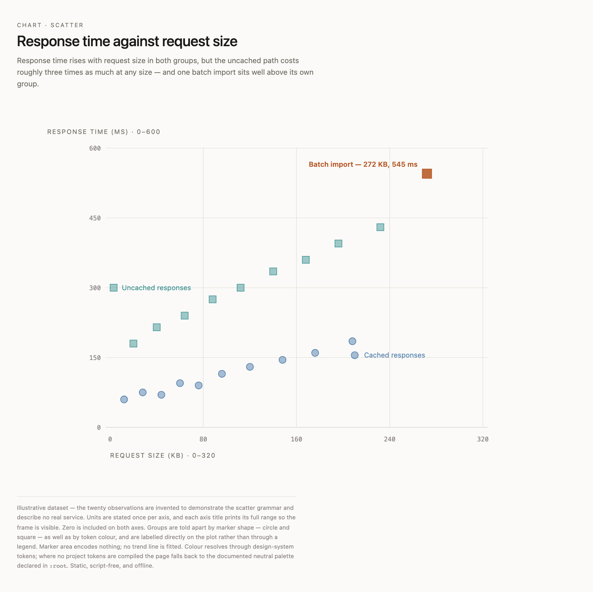</picture></a><br><sub><b>scatter</b></sub></td>
<td width="33%"><a href="https://jangtrinh.github.io/design-os/examples/charts/timeline.html" title="Release history, 2025 — open the live artifact"><picture><source media="(prefers-color-scheme: dark)" srcset="docs/images/examples/charts/timeline-dark.png">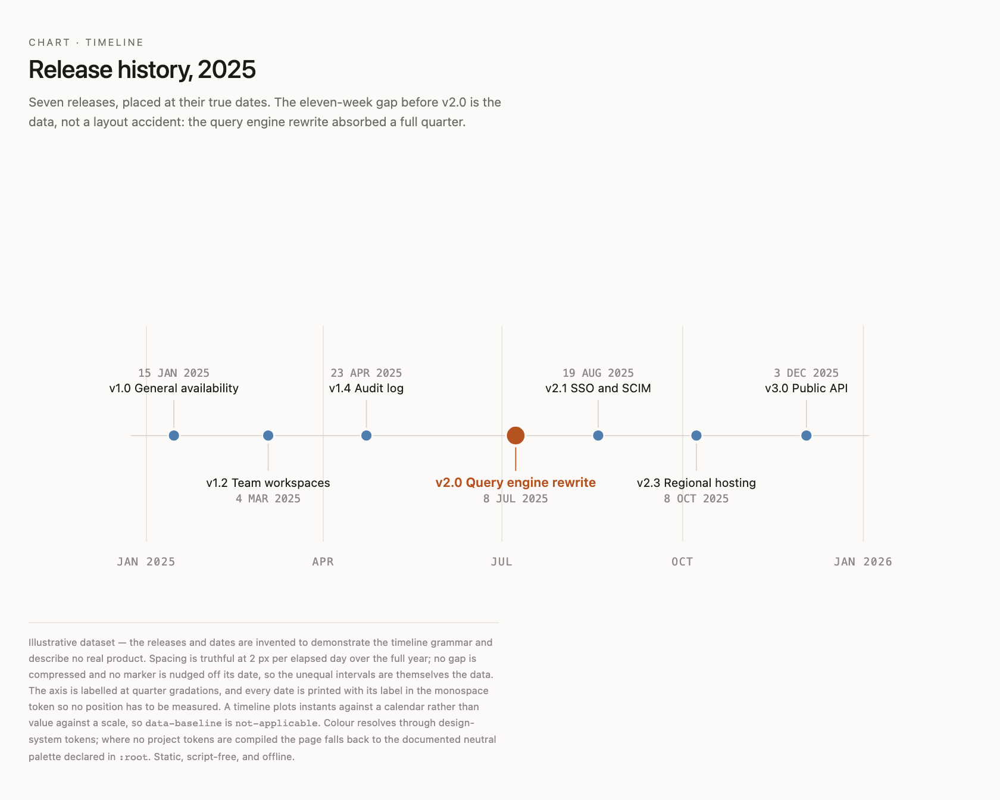</picture></a><br><sub><b>timeline</b></sub></td>
<td width="33%"><a href="https://jangtrinh.github.io/design-os/examples/charts/venn.html" title="Overlap between three workspace roles — open the live artifact"><picture><source media="(prefers-color-scheme: dark)" srcset="docs/images/examples/charts/venn-dark.png">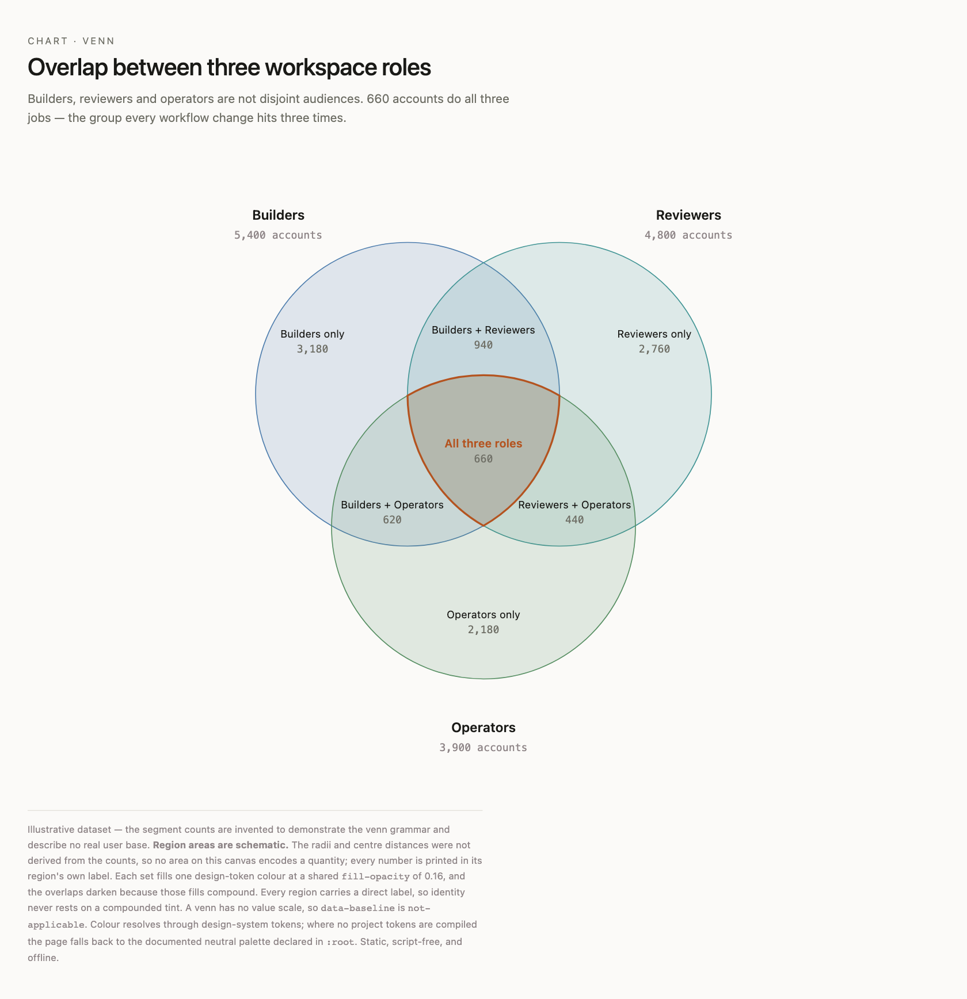</picture></a><br><sub><b>venn</b></sub></td>
</tr>
</table>

</details>

<!-- END:examples-grid -->


## Limits

- The CLI compiles, checks and seals. It never calls a model, installs dependencies or fetches a Figma library. The agent is your own coding agent.
- `ui agents init` renders one roster for Claude Code, Codex and Antigravity; `ui init --with-agents` writes the Claude Code agents only.
- The Figma path needs a scan from [Bridge](https://github.com/jangtrinh/design-os-figma-plugin). The CSS path reads custom properties only.
- A capture is only as complete as its source. A partial capture stays partial; the kit gates refuse to mark it complete.
- `ui gate` and `ui ds a11y` are floors, not conformance claims.

## Watch

Talks on the Autonomous Design Agent from the [design:os by Jang](https://www.youtube.com/@designosbyjang) channel (Vietnamese, with English terms):

<p align="left">
  <a href="https://www.youtube.com/watch?v=cUOa9g1E-fA">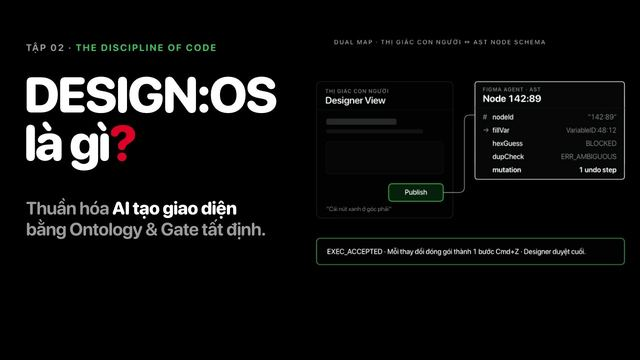</a>
  <a href="https://www.youtube.com/watch?v=wxFz82DTu_o">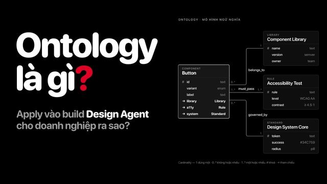</a>
  <a href="https://www.youtube.com/watch?v=OYWsj7Jt8aw">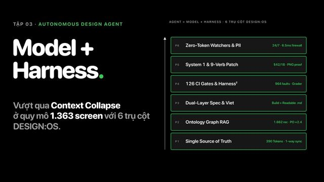</a>
</p>

- [Xây dựng autonomous design agent cho doanh nghiệp? how?](https://www.youtube.com/watch?v=cUOa9g1E-fA) (7:06): How the DESIGN:OS CLI, plugin bridge and deterministic gates turn an ontology into an autonomous design agent for enterprise design systems. Vietnamese, with English terms.
- [Ontology là gì? apply vào build AI design agent như thế nào?](https://www.youtube.com/watch?v=wxFz82DTu_o) (7:33): What an ontology is and how it grounds an AI design agent: shared vocabulary, semantic RAG and reusable design decisions. Vietnamese, with English terms.
- [Autonomous Design Agent · Tập 03: Model + Harness và 6 trụ cột DESIGN:OS](https://www.youtube.com/watch?v=OYWsj7Jt8aw) (8:44): Agent = Model + Harness: the six pillars of DESIGN:OS (single source of truth, Ontology Graph RAG, dual-layer spec, 126 CI gates, 9-verb patch, watchers). Vietnamese, with English terms.

Autonomous Design Agent (ADA) short series, six short episodes (Vietnamese, with English terms; English-titled playlist: [ADA (English)](https://www.youtube.com/playlist?list=PLAgHz-2MRSJw), Vietnamese playlist: [ADA · Tiếng Việt](https://www.youtube.com/playlist?list=PLSEs3nxfIWqo)):

1. [Storybook + W3C DTCG Tokens: Hard Boundaries for Designers and AI Agents](https://www.youtube.com/watch?v=4frBjPmXH1U) (3:10)
2. [Ontology Graph RAG: Why AI Picks the Wrong UI Component](https://www.youtube.com/watch?v=ox2ReqYqS78) (3:02)
3. [Spec-Driven Development: Lock the Spec Before AI Writes Code](https://www.youtube.com/watch?v=GHkxR-TzR24) (2:25)
4. [Harness 2.0: The Control Frame That Keeps AI Agents Out of Endless Loops](https://www.youtube.com/watch?v=klBRG-kIKJg) (2:43)
5. [Two-way bridge: One Comment, the AI Fixes Design and Code](https://www.youtube.com/watch?v=c6yc314JsTI) (2:44)
6. [Watchers, a 2-Mac Cluster and PII Guard: Infrastructure for Long-Running AI Agents](https://www.youtube.com/watch?v=9XliozE3uT8) (2:06)

More: [Autonomous Design Agent series](https://www.youtube.com/@designosbyjang/playlists).


## DESIGN:OS

The CLI is one of the DESIGN:OS tools. The others: [Studio](https://github.com/jangtrinh/design-os-studio), [Bridge](https://github.com/jangtrinh/design-os-figma-plugin), [3D Blender](https://github.com/jangtrinh/design-os-3d-blender), [SVG Animation](https://github.com/jangtrinh/design-os-svg-animation), [Code2Flow](https://github.com/jangtrinh/design-os-code2flow), [Knowledge Builder](https://github.com/jangtrinh/design-os-knowledge-builder) and more on [jangtrinh.github.io](https://jangtrinh.github.io/).

Docs: [jangtrinh.github.io/design-os](https://jangtrinh.github.io/design-os/) · Changelog: [CHANGELOG.md](CHANGELOG.md) · Index for AI agents: [llms.txt](llms.txt)

## Contributing and license

- [CONTRIBUTING.md](CONTRIBUTING.md) · [CODE_OF_CONDUCT.md](CODE_OF_CONDUCT.md) · [SECURITY.md](SECURITY.md) · [PRIVACY.md](PRIVACY.md)
- [PolyForm Shield 1.0.0](LICENSE). FREE to use and modify, including for paid client work; you may not resell it or build a competing product from it.

Listed on [dalisoft/awesome-ai-coding](https://github.com/dalisoft/awesome-ai-coding), [Skills Directory](https://www.skillsdirectory.com/skills/jangtrinh-design-os), [Piebald-AI/awesome-gemini-cli](https://github.com/Piebald-AI/awesome-gemini-cli/blob/main/README.md) and [SkillsMP](https://skillsmp.com/creators/jangtrinh).

Built by [Jang Trịnh](https://github.com/jangtrinh), creative technologist and autonomous system architect.
